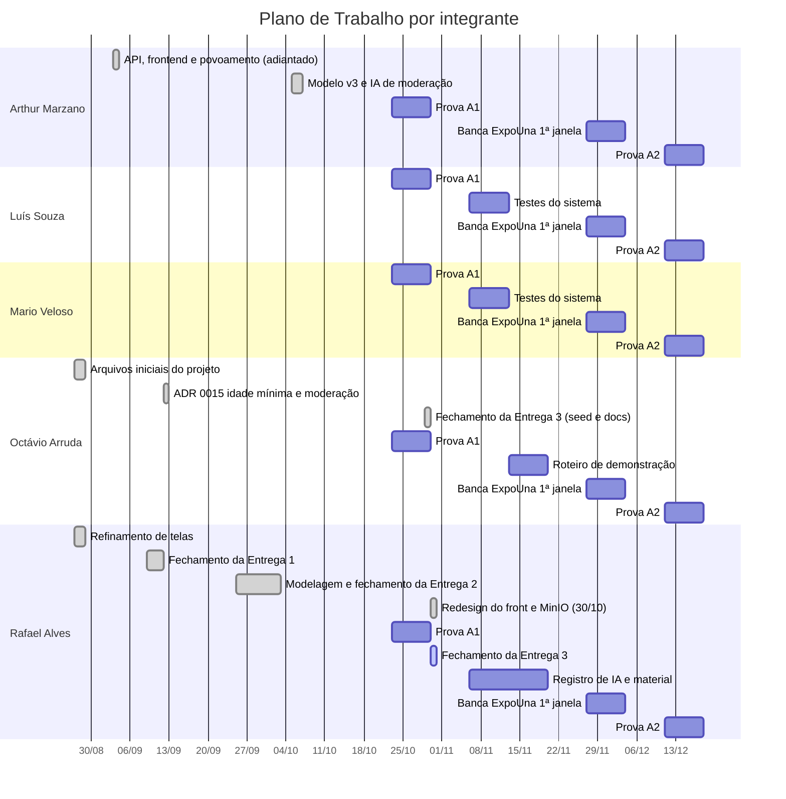

# 07 - Plano de Trabalho

Cronograma do Projeto A3, no formato pedido pelo Anexo 1 da ficha de
inscrição (semana a semana, ligado às datas de revisão em sala definidas pelo
professor). O status de cada etapa reflete o estado real do repositório — as
datas ainda não vencidas mostram o planejado, as vencidas mostram o que
efetivamente aconteceu (ver histórico de commits).

Para o status de cada **entrega formal** (o que precisa estar pronto em cada
data de revisão), ver [07 - Entregas](../07-entregas/README.md). Este
documento é sobre a semana a semana; aquele é sobre "o que a entrega N
exige".

## Como ler a coluna Responsável

* Nas semanas **vencidas**, o responsável sai do histórico de commits e PRs do
  repositório. Trabalho feito em reunião ou fora do Git não aparece — quem
  não tem commit não está sem participação, está sem rastro aqui.
* Nas semanas **futuras**, o responsável é uma **proposta** (marcada com
  *(proposto)*) derivada da função de cada integrante em
  [Distribuição de responsabilidades](#distribuição-de-responsabilidades). O
  time ainda precisa confirmar.

## E1 — Proposta e Requisitos

| Semana | Atividade | Responsável | Status |
| --- | --- | --- | --- |
| 27–28/08 | Definição do problema, refinamento de telas iniciais | Octávio Arruda (arquivos `.md` iniciais), Rafael Alves (refinamento das telas) | ✅ Concluído |
| 04/09 | Levantamento de requisitos, regras de negócio, justificativa | Sem commit próprio na semana — a confirmar com o time | ✅ Concluído |
| 03/09 | *(fora da grade, adiantado)* modelagem, DER, schema, API, frontend e povoamento implementados de uma vez | Arthur Araujo Marzano | ✅ Concluído |
| 11/09 | **Revisão de Projeto em sala** (RT01) — fechamento da Entrega 1 | Rafael Alves (ficha, resposta-síntese, tag), Octávio Arruda (ADR 0015) | ✅ Concluído — 9/9, tag `entrega-1` enviada |

## E2 — Modelagem

| Semana | Atividade | Responsável | Status |
| --- | --- | --- | --- |
| 18/09 | Revisão da modelagem contra o schema já implementado | Rafael Alves | ✅ Concluído — feita em 02/10, junto com os ajustes abaixo |
| 25/09 | Ajustes de DER/modelo lógico conforme feedback da revisão de 11/09 | Rafael Alves, Octávio Arruda (ADR 0015) | ✅ Concluído — modelagem de idade mínima e moderação por IA (RT01, ADR 0015); em 02/10, simplificação do modelo para 10 tabelas em schema único (ADR 0016) |
| 02/10 | **Revisão de Projeto em sala** — fechamento da Entrega 2 | Rafael Alves | ✅ Concluído — 8/8, tag `entrega-2` enviada |

## E3 — Banco de Dados

| Semana | Atividade | Responsável | Status |
| --- | --- | --- | --- |
| 09/10 | Revisão de constraints, índices e consultas analíticas | Arthur Araujo Marzano (modelo v3 e IA de moderação, 05–06/10), Octávio Arruda (seed, consultas e documentos, 29/10) | ✅ Concluído — PRs #3 e #32 na `main` em 29/10, 147 testes passando |
| 16/10 | Recesso do professor | — | — |
| 23/10 | **Semana Prova A1** — presencial em sala (15 pontos, individual) | Todos, individualmente | ➖ Individual, em sala — sem rastro no repositório |
| 30/10 | **Revisão de Projeto em sala** — fechamento da Entrega 3 | Rafael Alves (PRs #34 a #36: redesign do front e MinIO), Octávio Arruda (PR #33: GitBook e registros de IA) | 🔵 Em andamento hoje — 8/8 itens do checklist; tag `entrega-3` após a revisão |

## E4 — Sistema Funcional e Banca ExpoUna (1ª janela)

| Semana | Atividade | Responsável | Status |
| --- | --- | --- | --- |
| 06/11 | Testes do sistema, registro de uso de IA | Luís Phillipe Pedra Souza, Mario Lana Veloso Junior (testes); Rafael Alves (registro de IA) *(proposto)* | ⚪ Planejado |
| 13/11 | Preparação da apresentação e roteiro de demonstração | Octávio Arruda (roteiro), Rafael Alves (material) *(proposto)* | ⚪ Planejado |
| 20/11 | Feriado (Consciência Negra) — **fechamento da Entrega 4 é virtual, pelo GitBook**, em vez de revisão presencial | Rafael Alves *(proposto)* | ⚪ Planejado |
| 27/11 | **Banca ExpoUna (1ª janela)** — apresentação do Projeto A3 (20 pontos, 2 ou 3 grupos nesta janela) | Todos | ⚪ Planejado |

> O Anexo 1 original (ficha de inscrição) imprime essa semana como "20/12",
> o que quebra a sequência cronológica das outras semanas (06/11 → 13/11 →
> 20/12 → 27/11). Lendo como **20/11** — erro de digitação — a sequência
> fecha certinho, e 20/11 é feriado nacional (Consciência Negra, Lei
> 14.759/2023), o que explica por que o Anexo 1 marca essa entrega como
> virtual pelo GitBook em vez de revisão em sala. Isso também bate com o
> "Data Revisão: 20/11" da Entrega 4 em
> [07-entregas/entrega-4-sistema-funcional.md](../07-entregas/entrega-4-sistema-funcional.md).
> Interpretação com boa confiança, mas ainda vale confirmar com o professor
> antes da semana em questão.

## E5 — Banca ExpoUna (2ª janela) e encerramento

| Semana | Atividade | Responsável | Status |
| --- | --- | --- | --- |
| 04/12 | **Banca ExpoUna** — apresentação do Projeto A3 (20 pontos, 2 ou 3 grupos nesta janela) | Todos | ⚪ Planejado |
| 11/12 | **Semana Prova A2** — presencial em sala (15 pontos, individual) | Todos, individualmente | ⚪ Planejado |
| 18/12 | Fim do semestre letivo | — | — |

> O grupo ainda não sabe em qual das duas janelas (20/11 ou 04/12) vai
> apresentar — isso é definido pelo professor. Os documentos de
> [Entrega 4](../07-entregas/entrega-4-sistema-funcional.md) e
> [Banca Final](../07-entregas/banca-final.md) usam essas duas datas como
> referência; ajustar assim que a janela for confirmada.

## Visão semanal por integrante

Mesmo conteúdo das tabelas acima, agora com uma faixa por pessoa. Barras
preenchidas são trabalho concluído (com base no Git); as demais são a
proposta para as semanas que faltam. Provas individuais (23/10 e 11/12) e
bancas (27/11 e 04/12) envolvem todos e aparecem na faixa de cada um.

## Distribuição de responsabilidades

Exigência da seção 2 do edital, para permitir identificar a participação de
cada integrante nas diferentes etapas.

| Integrante | Responsabilidade |
| --- | --- |
| Arthur Araujo Marzano | Melhoria contínua |
| Luís Phillipe Pedra Souza | Testes |
| Mario Lana Veloso Junior | Testes |
| Octávio Arruda | Product Owner |
| Rafael Martins Alves | Documentação |
