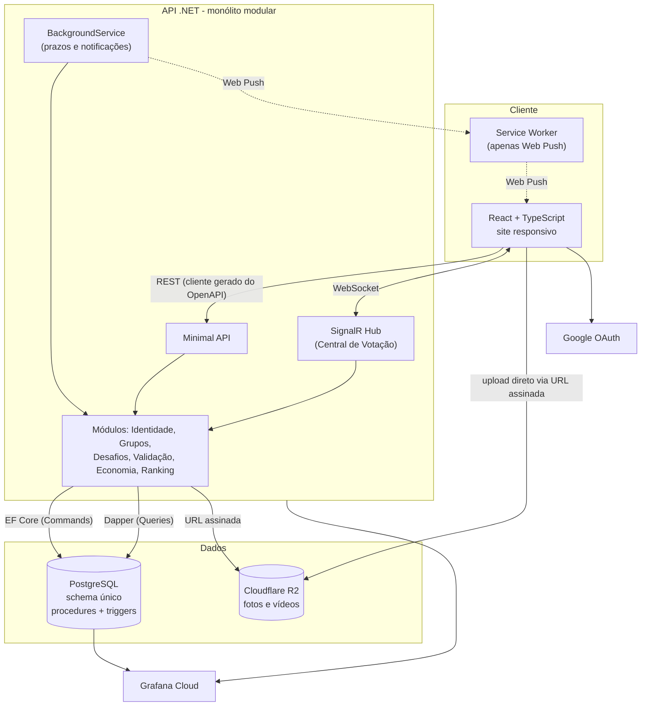
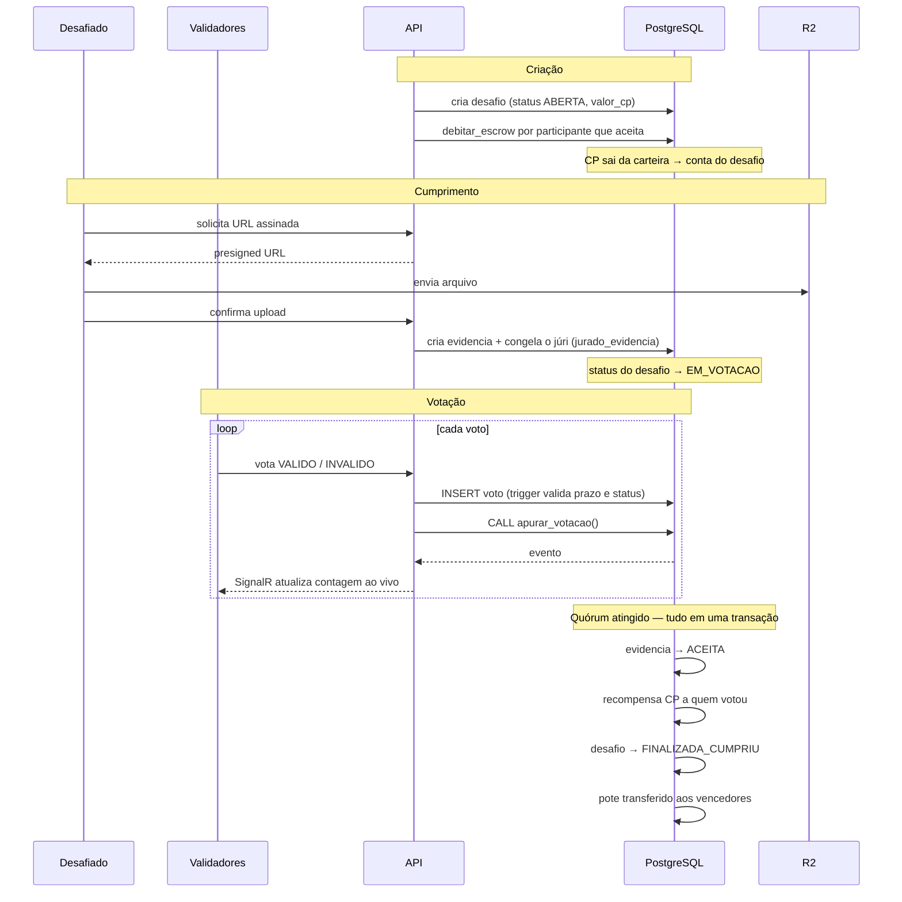

# 13 - Visão Geral da Arquitetura

## Em uma frase

Um monólito modular em C# expõe uma API REST consumida por um site React
responsivo; toda a integridade e a apuração de resultados vivem em um único
PostgreSQL; arquivos de evidência ficam em object storage, referenciados por URL.

## Componentes



## Onde cada responsabilidade mora

| Camada | Responsabilidade | O que **não** faz |
| --- | --- | --- |
| React | Renderizar, capturar entrada, enviar arquivo ao R2 | Nenhuma regra de negócio |
| Minimal API | Autenticar, validar entrada, orquestrar o caso de uso | Não decide resultado de desafio |
| Domínio (C#) | Invariantes de agregado, máquina de estados, `Result` | Não acessa banco diretamente |
| **PostgreSQL** | **Integridade referencial, apuração de quórum, liquidação de CP** | — |
| R2 | Guardar bytes | Não sabe nada do domínio |

A linha em negrito é deliberada. A decisão estrutural mais importante do projeto
é que **a apuração de votos e a liquidação de CP acontecem dentro do banco, em
uma única transação** ([ADR 0008](adr/0008-quorum-congelado.md)). Não existe
estado intermediário em que a evidência foi aceita mas o CP não foi transferido.

## Os seis módulos

| Módulo | Agregado raiz | Schema no Postgres | Natureza |
| --- | --- | --- | --- |
| Identidade | Usuario | `identidade` | Command + Query |
| Grupos | Grupo | `grupos` | Command + Query |
| Desafios | Desafio | `desafios` | Command + Query |
| Validação | Evidencia | `validacao` | Command + Query |
| Economia | Carteira | `economia` | Command + Query |
| Ranking | — | (lê os demais) | **Somente Query** |

**Validação é módulo separado de Desafios** porque é onde vivem o quórum, a
máquina de estados e a procedure de apuração — a parte mais complexa do sistema,
isolada para ser testável sozinha.

**Ranking não tem Command algum.** É o módulo que exercita o lado de leitura do
CQRS de forma pura: só Dapper, só SQL, nenhuma escrita.

## Fluxo principal

O ciclo de vida completo de um desafio, da moderação à liquidação:



## Decisões que definem esta arquitetura

| Decisão | ADR |
| --- | --- |
| C# + React + PostgreSQL | [0001](adr/0001-stack-tecnologica.md) |
| Monólito modular com vertical slice | [0002](adr/0002-monolito-modular-vertical-slice.md) |
| CQRS: Dapper lê, EF escreve | [0003](adr/0003-cqrs-dapper-ef.md) |
| `schema.sql` gerado por migration | [0004](adr/0004-schema-sql-gerado-por-migration.md) |
| ~~Um schema Postgres por módulo~~ → schema único e modelo enxuto | ~~[0005](adr/0005-schema-por-modulo-postgres.md)~~ → [0016](adr/0016-schema-unico-e-modelo-enxuto.md) |
| CP como moeda única | [0006](adr/0006-cp-como-moeda.md) |
| Ledger append-only com escrow | [0007](adr/0007-ledger-append-only.md) |
| Validadores congelados por evidência | [0008](adr/0008-quorum-congelado.md) |
| Mídia no R2 com URL assinada | [0009](adr/0009-armazenamento-de-midia-r2.md) |
| Hospedagem e deploy | [0010](adr/0010-hospedagem-e-deploy.md) |
| ~~Notificações e tempo real~~ (substituído) | ~~[0011](adr/0011-notificacoes-web-push.md)~~ → [0016](adr/0016-schema-unico-e-modelo-enxuto.md) |
| Idade mínima e moderação por IA | [0015](adr/0015-idade-minima-e-moderacao-ia.md) |
| "Desafio" no lugar de "aposta" | [0017](adr/0017-desafio-no-lugar-de-aposta.md) |
| Saída de membro e invariante do ledger | [0018](adr/0018-saida-de-membro-e-invariante-do-ledger.md) |
| Contrato via OpenAPI | [0012](adr/0012-contrato-openapi.md) |
| Observabilidade | [0013](adr/0013-observabilidade.md) |
| Estratégia de testes | [0014](adr/0014-estrategia-de-testes.md) |

## Restrições técnicas conhecidas

Verificadas na documentação dos fornecedores. Importam porque cada uma exige uma
decisão de implementação que é fácil descobrir tarde demais.

| Restrição | Origem | O que fazer |
| --- | --- | --- |
| Aiven free: **20 conexões**, sem pooling | [Aiven docs](https://aiven.io/docs/products/postgresql/concepts/pg-free-tier) | Definir `Maximum Pool Size=15` na connection string — o padrão do Npgsql é 100. EF, Dapper e SignalR compartilham o mesmo pool. |
| Aiven free: 1 CPU, 1 GB RAM, 1 GB disco | Aiven docs | Suficiente para a demonstração; monitorar pelo Grafana. |
| Sem `plpythonu`/`plperlu` (exigem superusuário) | Aiven docs | Irrelevante — todas as procedures usam `plpgsql`, que é permitido. |
| EF Core não possui `migrationBuilder.SqlFile()` | [MS Learn](https://learn.microsoft.com/en-us/ef/core/managing-schemas/migrations/operations) | Carregar o `.sql` como *embedded resource* e passar a string para `migrationBuilder.Sql()`. |
| Transação manual é incompatível com `EnableRetryOnFailure` | [MS Learn](https://learn.microsoft.com/en-us/ef/core/saving/transactions) | Envolver a unidade de trabalho em `strategy.ExecuteAsync(...)`. |
| Npgsql não tem MARS | Npgsql | Materializar (`ToListAsync`) antes de emitir comando Dapper na mesma conexão. |
| Uniões discriminadas em C# são *preview* | [MS Learn](https://learn.microsoft.com/en-us/dotnet/csharp/whats-new/csharp-15) | Usar biblioteca de `Result`; unions são refatoração futura, não opção atual. |

## Estrutura de pastas

```text
apps/
  api/                      # .NET
    Modules/
      Desafios/
        Domain/             # agregado, invariantes, Result
        Features/
          CriarDesafio/      # Command + Handler + Validator + Endpoint
          ListarDesafios/    # Query + Handler (Dapper) + Endpoint
        Infrastructure/     # adaptadores das portas
      Validacao/
      Economia/
      ...
  web/                      # React
    src/
      features/
        votacao/
          components/       # burros: só recebem props
          views/            # visuais: compõem os burros
          hooks/            # inteligência: useVotacaoQuery, useVotarCommand
      shared/
database/
  scripts/
    ddl/
      schema.sql            # GERADO — não editar
      functions/            # procedures, triggers, views (escritos à mão)
    dml/
    queries/
```
