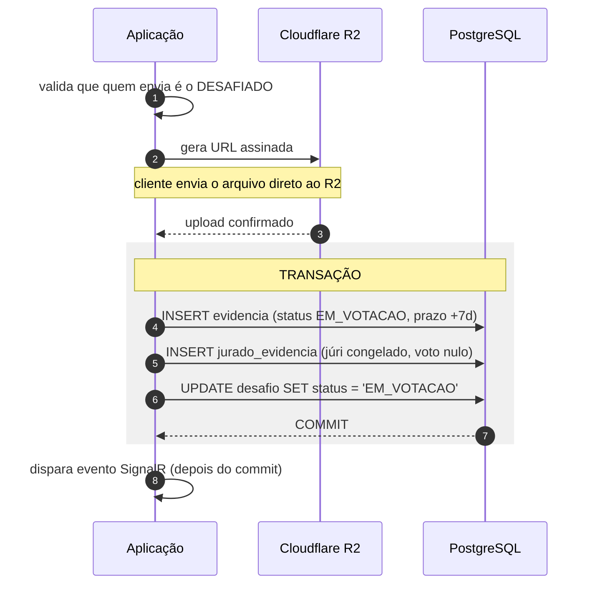
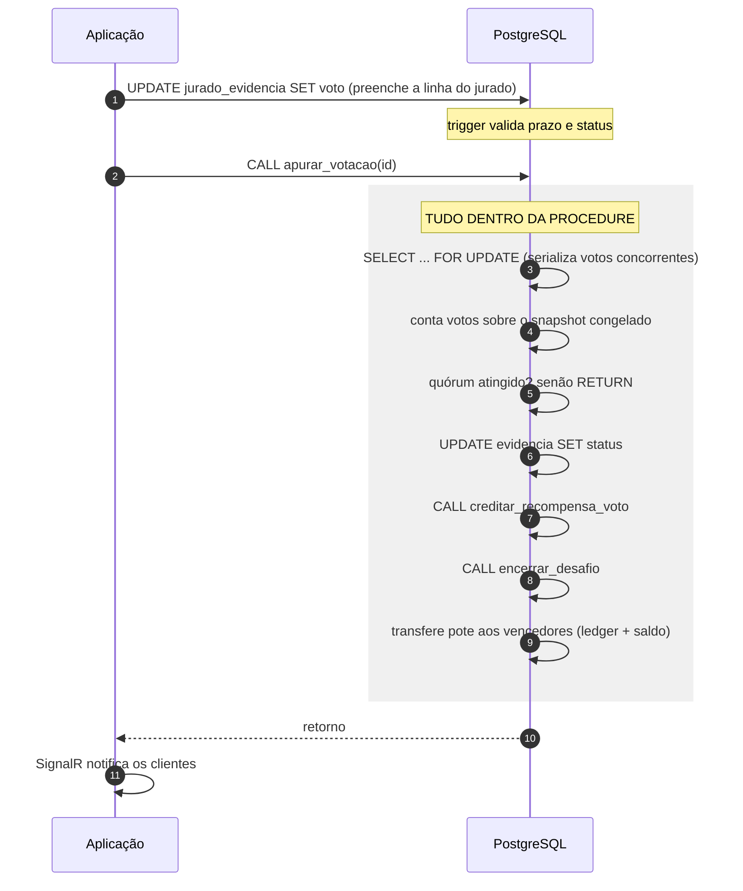

# 15 - Integração Sistema e Banco de Dados

Como a aplicação conversa com o SGBD, e por que a parte mais importante da
lógica de resultado **não** está na aplicação.

## Princípio

O sistema não decide o resultado de um desafio. Ele registra votos e **pede ao
banco que apure**. A apuração de quórum, a mudança de status e a liquidação de CP
acontecem dentro de uma procedure PostgreSQL, em uma única transação.

A razão é de correção, não de estilo: se a aplicação contasse os votos, mudasse o
status e depois transferisse o CP em três operações separadas, uma falha entre
elas deixaria o sistema num estado impossível — evidência aceita, desafio aberto,
CP no limbo. Dentro da transação, ou tudo acontece ou nada acontece.

## Os dois caminhos de acesso

A separação de leitura e escrita ([ADR 0003](adr/0003-cqrs-dapper-ef.md)) define
dois caminhos distintos até o mesmo banco:

| Caminho | Tecnologia | Usa para |
| --- | --- | --- |
| **Command** | EF Core | Criar, alterar, invocar procedures |
| **Query** | Dapper + SQL à mão | Toda leitura, incluindo as consultas analíticas |

Regra verificada no CI: um Query nunca toca o EF, um Command nunca lê pelo
Dapper.

## Fluxo transacional: submissão de prova

O caso mais completo do sistema, ponta a ponta.



O passo 4 é o que a maioria dos sistemas erra: a linha em `evidencia` só é criada
**depois** que o R2 confirma o upload. Criar antes deixaria `url_comprovante`
apontando para um arquivo que não existe, e o júri votaria numa prova fantasma
([ADR 0009](adr/0009-armazenamento-de-midia-r2.md)).

## Fluxo transacional: encerramento após apuração



Três detalhes que a procedure resolve e que seriam armadilha na aplicação:

* **`SELECT ... FOR UPDATE`** — dois votos simultâneos não podem apurar em
  paralelo e fechar o desafio duas vezes.
* **Idempotência** — chamar `apurar_votacao` numa evidência já apurada não faz
  nada. A aplicação pode chamar sem medo após cada voto.
* **Escrita dupla no ledger** — cada movimento de CP gera débito e crédito na
  mesma transação, mantendo a reconciliação válida a todo instante.

## Onde a aplicação ainda decide

Nem tudo desce para o banco. A aplicação continua responsável por:

* Autenticar e autorizar (quem pode votar nesta evidência, quem é `ADMIN`).
* Validar entrada antes do handler.
* Orquestrar o que não é atômico — gerar URL assinada, disparar Web Push.
* Traduzir `Result.Fail` em status HTTP.

## Cuidados com o Npgsql

Restrições reais do ambiente, verificadas na documentação:

| Cuidado | Motivo |
| --- | --- |
| `Maximum Pool Size=15` na connection string | Aiven free permite 20 conexões e não oferece pooling; o padrão do Npgsql é 100 |
| Materializar com `ToListAsync` antes de comando Dapper na mesma conexão | Npgsql não tem MARS |
| Passar `transaction:` explicitamente em toda chamada Dapper | O Dapper não descobre a transação do EF sozinho |
| Envolver em `strategy.ExecuteAsync(...)` se usar `EnableRetryOnFailure` | Transação manual é incompatível com a estratégia de retentativa |

Para compartilhar transação entre EF e Dapper:

```csharp
await using var tx = await db.Database.BeginTransactionAsync();
var conn  = db.Database.GetDbConnection();     // não descartar: o EF é o dono
var dbTx  = tx.GetDbTransaction();
var linhas = await conn.QueryAsync<Foo>(sql, param, transaction: dbTx);
await db.SaveChangesAsync();
await tx.CommitAsync();
```
