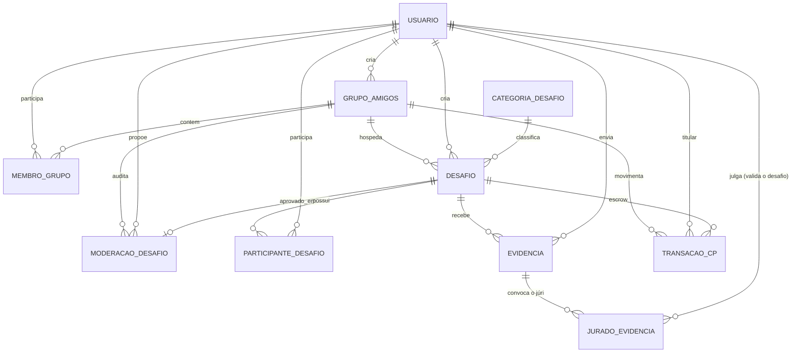
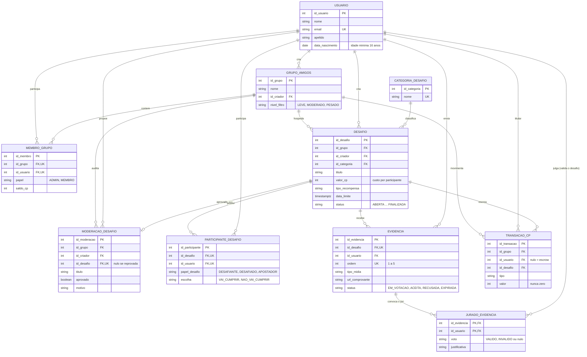

# 10 - Diagrama Entidade-Relacionamento (DER)

Dez entidades em um único schema, agrupadas em cinco áreas. O que mudou desde
o primeiro desenho e por quê está em [09 - Evolução](09-evolucao-modelagem.md).

## DER com chaves

Mesmas dez entidades, agora com os atributos e as chaves: **PK** chave
primária, **FK** chave estrangeira, **UK** unicidade. Colunas de auditoria
(`data_*`) e textos livres menores foram omitidos para o diagrama caber em um
slide; a lista completa está em [11 - Modelo Lógico](11-modelo-logico.md).

### Chaves estrangeiras, uma a uma

| Tabela | Coluna FK | Referencia | Ao apagar o pai |
| --- | --- | --- | --- |
| `grupo_amigos` | `id_criador` | `usuario` | restringe |
| `membro_grupo` | `id_grupo` | `grupo_amigos` | apaga em cascata |
| `membro_grupo` | `id_usuario` | `usuario` | apaga em cascata |
| `desafio` | `id_grupo` | `grupo_amigos` | apaga em cascata |
| `desafio` | `id_criador` | `usuario` | restringe |
| `desafio` | `id_categoria` | `categoria_desafio` | restringe |
| `moderacao_desafio` | `id_grupo` | `grupo_amigos` | apaga em cascata |
| `moderacao_desafio` | `id_criador` | `usuario` | restringe |
| `moderacao_desafio` | `id_desafio` | `desafio` | `SET NULL` |
| `participante_desafio` | `id_desafio` | `desafio` | apaga em cascata |
| `participante_desafio` | `id_usuario` | `usuario` | restringe |
| `evidencia` | `id_desafio` | `desafio` | apaga em cascata |
| `evidencia` | `id_usuario` | `usuario` | restringe |
| `jurado_evidencia` | `id_evidencia` | `evidencia` | apaga em cascata |
| `jurado_evidencia` | `id_usuario` | `usuario` | restringe |
| `transacao_cp` | `id_grupo` | `grupo_amigos` | apaga em cascata |
| `transacao_cp` | `id_usuario` | `usuario` | restringe |
| `transacao_cp` | `id_desafio` | `desafio` | restringe |

"Restringe" significa que o banco recusa apagar o registro pai enquanto
houver filho (`RESTRICT`). É o que vale para toda FK sem `ON DELETE` explícito
no [modelo lógico](11-modelo-logico.md).

## Leitura das relações

Cada relação lida nos dois sentidos. "Muitos" inclui zero, salvo onde diz
"pelo menos".

**Usuário e grupo — `membro_grupo`**
* Um usuário pode participar de vários grupos; cada participação é uma linha de
  `membro_grupo`, com papel e saldo próprios.
* Um grupo contém vários membros (pelo menos o criador).
* Um usuário pode criar vários grupos; cada grupo tem um único criador.

**Grupo, usuário e categoria — `desafio`**
* Um grupo hospeda vários desafios; cada desafio pertence a um único grupo.
* Um usuário pode criar vários desafios; cada desafio tem um único criador.
* Uma categoria classifica vários desafios; cada desafio tem uma única categoria.

**Moderação — `moderacao_desafio`**
* Um grupo audita várias moderações; cada moderação pertence a um único grupo.
* Um usuário pode propor várias propostas de desafio à moderação; cada moderação tem um
  único autor.
* Um desafio tem, no máximo, uma moderação; uma moderação aprovada gera um desafio, e uma reprovada não gera nenhuma.

**Participação — `participante_desafio`**
* Um desafio possui vários participantes, um único `DESAFIANTE`, um único
  `DESAFIADO` e quantos `APOSTADOR` houver.
* Um usuário pode participar de vários desafios, mas com um único papel em cada
  uma.

**Prova — `evidencia`**
* Um desafio recebe até cinco evidências, em sequência.
* Um usuário pode enviar várias evidências; cada evidência tem um único autor.

**Júri — `jurado_evidencia`**
* Uma evidência convoca vários jurados, fixados no envio e imutáveis depois.
* Um usuário pode julgar várias evidências, mas vota uma única vez em cada.
* Cada jurado tem no máximo um voto por evidência, que começa vazio.

**Economia — `transacao_cp`**
* Um grupo movimenta vários lançamentos de CP; cada lançamento pertence a um
  único grupo.
* Um usuário pode ser titular de vários lançamentos; um lançamento sem usuário é
  a conta retida do desafio (escrow).
* Um desafio pode ter vários lançamentos, entre eles a retenção, o prêmio e os
  estornos.

## Entidades por área

| Área | Entidades | Pergunta que responde |
| --- | --- | --- |
| identidade | `usuario` | Quem é a pessoa? |
| grupos | `grupo_amigos`, `membro_grupo` | Em qual turma, com qual papel e saldo? |
| desafios | `categoria_desafio`, `desafio`, `moderacao_desafio`, `participante_desafio` | Qual é o desafio, ele passou na moderação e quem participa? |
| validacao | `evidencia`, `jurado_evidencia` | Qual a prova e quem julga? |
| economia | `transacao_cp` | Para onde foi cada moeda? |

## Entidades associativas

Três relações N:N, cada uma resolvida por uma tabela própria:

| Associativa | Resolve | Atributos próprios |
| --- | --- | --- |
| `membro_grupo` | Usuário × Grupo | `papel`, `saldo_cp`, `data_entrada` |
| `participante_desafio` | Usuário × Desafio | `papel_desafio`, `escolha` |
| `jurado_evidencia` | Usuário × Evidência | `voto`, `justificativa`, `data_voto` |

## O júri valida o desafio

O júri não vota no desafio diretamente: vota na **evidência** que o desafiado
enviou, e o resultado da votação decide o desafio. O caminho completo é:

1. O desafiado envia uma `evidencia` do desafio.
2. O sistema grava uma linha de `jurado_evidencia` para cada integrante elegível
   do grupo, com `voto` nulo.
3. Cada jurado preenche o próprio `voto` (`VALIDO` ou `INVALIDO`).
4. Ao atingir o quórum, a procedure de apuração grava o `status` da evidência
   (`ACEITA` ou `RECUSADA`) e encerra o desafio (`FINALIZADA_CUMPRIU` ou
   `FINALIZADA_PERDEU`), liquidando o CP na mesma transação.

Ou seja: **a validação do desafio é o voto do júri sobre a evidência**. Não
existe tabela separada para o resultado; ele é o `status` do próprio `desafio`.

## O júri em uma tabela só

`jurado_evidencia` junta duas ideias:

* **Quem pode votar.** Ao enviar a evidência, o sistema grava uma linha por
  integrante elegível, com `voto` nulo. Esse conjunto não muda mais — é o
  júri congelado ([ADR 0008](../../02-arquitetura/adr/0008-quorum-congelado.md)).
  Quem entrar no grupo depois não vota, e o quórum não flutua.
* **O que cada um votou.** Votar é preencher `voto` na linha que já existe.

Como a chave primária é `(id_evidencia, id_usuario)`, o banco garante sozinho
dois fatos: voto único por jurado e nenhum voto de quem não está no júri.
Quórum = `floor(count(*)/2) + 1` sobre as linhas da evidência.

## Moderação por IA

`moderacao_desafio` registra toda avaliação da proposta de desafio antes de ele existir. A
relação com `desafio` é **0..1**: proposta reprovada nunca vira desafio, então a FK
é opcional. Os outros dois elementos da exigência entram em entidades
existentes: `usuario.data_nascimento` (RN26) e `grupo_amigos.nivel_filtro`
(RN27). Origem: [ADR 0015](../../02-arquitetura/adr/0015-idade-minima-e-moderacao-ia.md).
