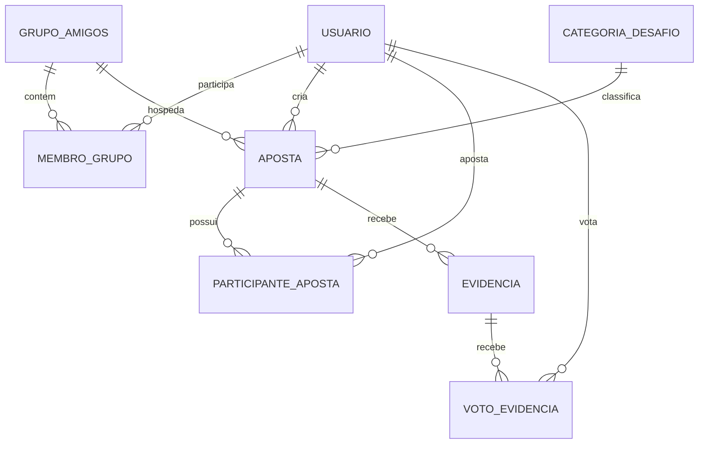
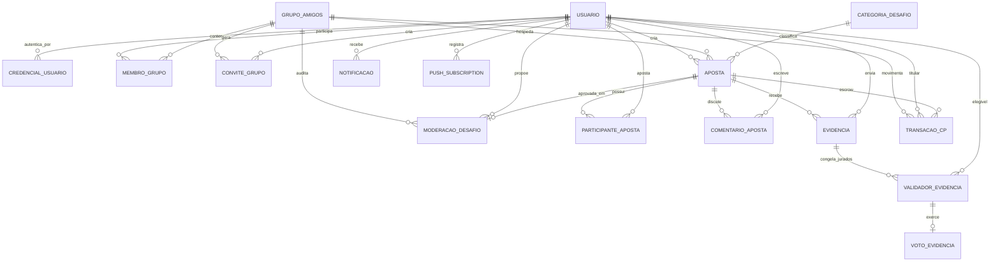

# 10 - Diagrama Entidade-Relacionamento (DER)

Entidades agrupadas pelos seis módulos do sistema. Cada módulo corresponde a um
schema no PostgreSQL ([ADR 0005](../../02-arquitetura/adr/0005-schema-por-modulo-postgres.md));
as chaves estrangeiras atravessam schemas normalmente.

## Visão MVP — o núcleo em 8 tabelas

Para ler o modelo pela primeira vez, comece por aqui. São as oito tabelas da v1
([09 - Evolução](09-evolucao-modelagem.md)): o que sobra se tirarmos tudo que
foi acrescentado depois para fechar regras de negócio. O DER completo vem na
sequência.

| Tabela | Papel |
| --- | --- |
| `usuario` | A pessoa. |
| `grupo_amigos` | A turma onde as apostas acontecem. |
| `membro_grupo` | Associativa usuário × grupo. |
| `categoria_desafio` | Tipo do desafio (3FN). |
| `aposta` | O desafio. |
| `participante_aposta` | Associativa usuário × aposta. |
| `evidencia` | Prova enviada pelo desafiado. |
| `voto_evidencia` | Voto de cada jurado. |

As outras sete tabelas de domínio são **extensões**, cada uma nascida de uma
regra que o núcleo não representava: `validador_evidencia` (júri congelado),
`transacao_cp` (ledger), `credencial_usuario`, `convite_grupo`,
`comentario_aposta`, `notificacao` e `push_subscription`. A
`moderacao_desafio` está só na modelagem (ADR 0015).

## DER completo

## Entidades por módulo

| Módulo | Entidades |
| --- | --- |
| `identidade` | `usuario`, `credencial_usuario` |
| `grupos` | `grupo_amigos`, `membro_grupo`, `convite_grupo` |
| `apostas` | `categoria_desafio`, `aposta`, `moderacao_desafio`, `participante_aposta`, `comentario_aposta` |
| `validacao` | `evidencia`, `validador_evidencia`, `voto_evidencia` |
| `economia` | `transacao_cp` |
| `notificacoes` | `notificacao`, `push_subscription` |

## Moderação por IA

`moderacao_desafio` ([ADR 0015](../../02-arquitetura/adr/0015-idade-minima-e-moderacao-ia.md))
registra toda avaliação do desafio antes de ele existir. A relação com `aposta`
é **0..1**: desafio reprovado nunca vira aposta, então a FK é opcional. Os
outros dois atributos novos do ADR entram em entidades existentes:
`usuario.data_nascimento` (RN26) e `grupo_amigos.nivel_filtro` (RN27).

## Entidades associativas

Quatro relações N:N foram resolvidas por entidade associativa:

| Associativa | Resolve | Atributos próprios |
| --- | --- | --- |
| `membro_grupo` | Usuário × Grupo | `papel`, `saldo_cp`, `data_entrada` |
| `participante_aposta` | Usuário × Aposta | `papel_aposta`, `escolha` |
| `validador_evidencia` | Usuário × Evidência | — (snapshot puro) |
| `voto_evidencia` | Validador × Evidência | `voto`, `justificativa` |

`validador_evidencia` merece destaque: não é uma associativa comum, é um
**snapshot congelado** dos elegíveis a votar no momento em que a evidência foi
enviada. Sem ela, o quórum flutuaria com o tamanho do grupo e o resultado de uma
aposta poderia mudar sozinho
([ADR 0008](../../02-arquitetura/adr/0008-quorum-congelado.md)).

Note também que `voto_evidencia` tem chave estrangeira **composta** apontando
para `validador_evidencia (id_evidencia, id_usuario)` — é o banco garantindo que
ninguém vota fora do júri congelado.
