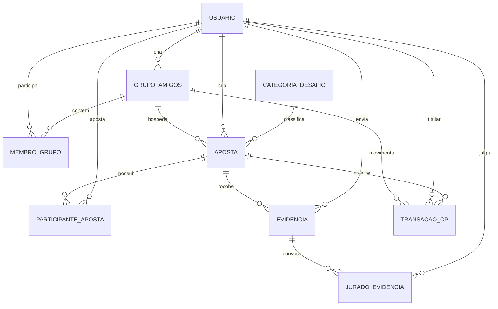

# 10 - Diagrama Entidade-Relacionamento (DER)

Nove entidades em um único schema, agrupadas em cinco áreas. O que mudou desde
o primeiro desenho e por quê está em [09 - Evolução](09-evolucao-modelagem.md).

## Entidades por área

| Área | Entidades | Pergunta que responde |
| --- | --- | --- |
| identidade | `usuario` | Quem é a pessoa? |
| grupos | `grupo_amigos`, `membro_grupo` | Em qual turma, com qual papel e saldo? |
| apostas | `categoria_desafio`, `aposta`, `participante_aposta` | Qual é o desafio e quem participa? |
| validacao | `evidencia`, `jurado_evidencia` | Qual a prova e quem julga? |
| economia | `transacao_cp` | Para onde foi cada moeda? |

## Entidades associativas

Três relações N:N, cada uma resolvida por uma tabela própria:

| Associativa | Resolve | Atributos próprios |
| --- | --- | --- |
| `membro_grupo` | Usuário × Grupo | `papel`, `saldo_cp`, `data_entrada` |
| `participante_aposta` | Usuário × Aposta | `papel_aposta`, `escolha` |
| `jurado_evidencia` | Usuário × Evidência | `voto`, `justificativa`, `data_voto` |

## O júri em uma tabela só

`jurado_evidencia` junta duas ideias:

* **Quem pode votar.** Ao enviar a evidência, o sistema grava uma linha por
  integrante elegível, com `voto` nulo. Esse conjunto não muda mais — é o
  júri congelado ([ADR 0008](../../02-arquitetura/adr/0008-quorum-congelado.md)).
  Quem entrar no grupo depois não vota, e o quórum não flutua.
* **O que cada um votou.** Votar é preencher `voto` na linha que já existe.

Como a chave primária é `(id_evidencia, id_usuario)`, o banco garante sozinho
dois fatos: voto único por jurado e nenhum voto de quem não está no júri.
Quórum = `floor(count(*)/2) + 1` sobre as linhas da evidência.
