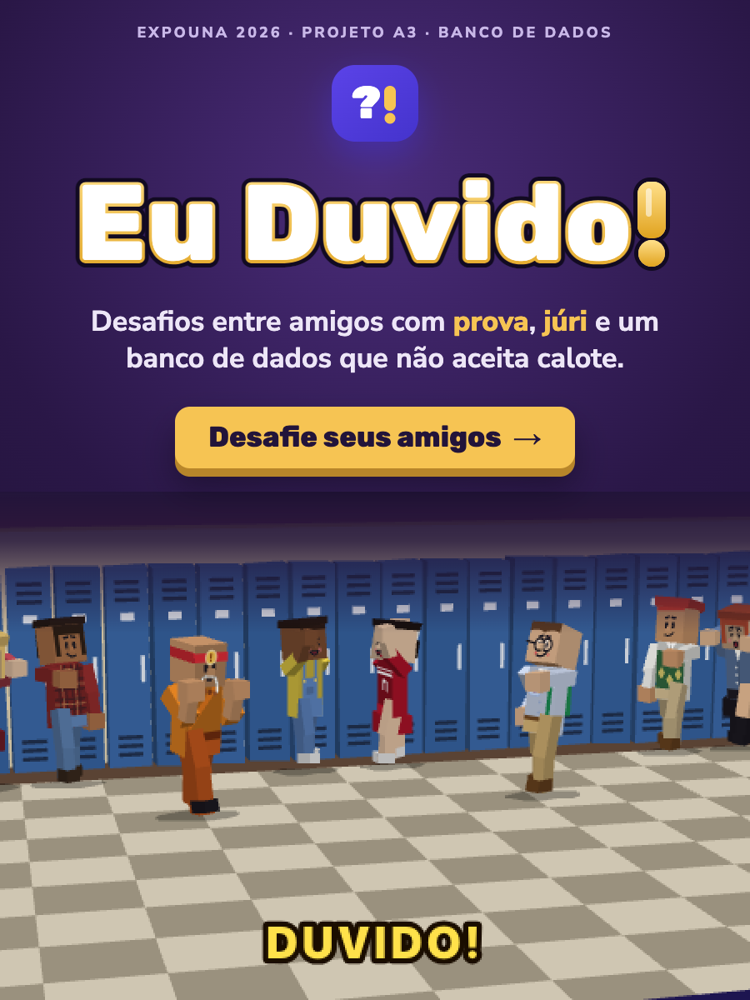

# Card da EXPOUNA 2026

Card de identidade visual do Eu Duvido! para a Vitrine Virtual da EXPOUNA 2026
(plataforma MostraPlus), pedido pelo professor em 20/11/2026.

| Orientação do professor | Como ficou |
| --- | --- |
| 900 x 1200, em retrato | `card-eu-duvido-900x1200.png`, PNG de 900 x 1200 |
| Texto na metade de cima | Marca, título, frase e botão nos primeiros 580 px |
| Hospedar no Imgur e colar o link na plataforma | Feito pelo PO na hora do cadastro |

**De onde vem cada peça:**

* **Metade de baixo:** um quadro real da abertura em 3D (tela 30), com o monge,
  o nerd e a plateia no corredor do colégio, capturado do app em 900 x 1200.
* **Título:** branco com borda dourada, como na abertura. O "!" é desenhado em
  SVG, porque o glifo da fonte em peso alto fecha o vão entre o traço e o ponto.
* **Marca "?!":** a mesma do ícone do app.

**Para refazer:** abra `card.html` num navegador em 900 x 1200 e capture a
página. O quadro de fundo é `cena-abertura-900x1200.png`.
