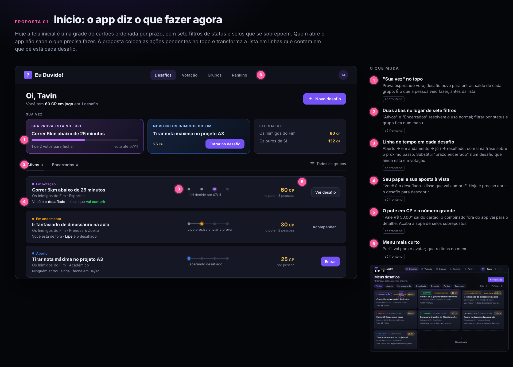
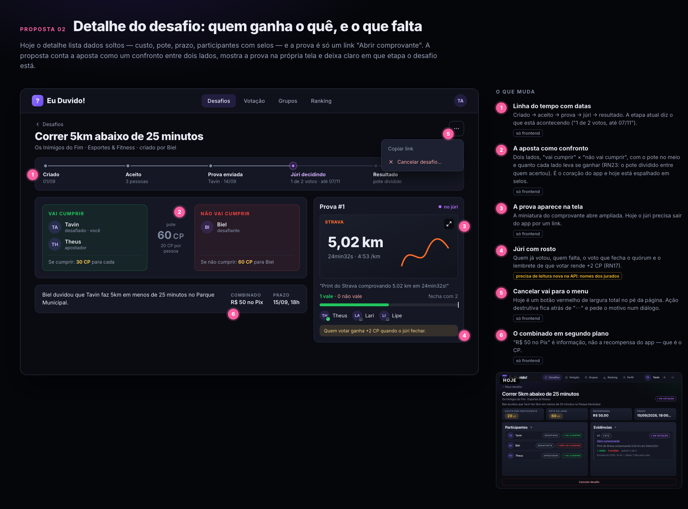
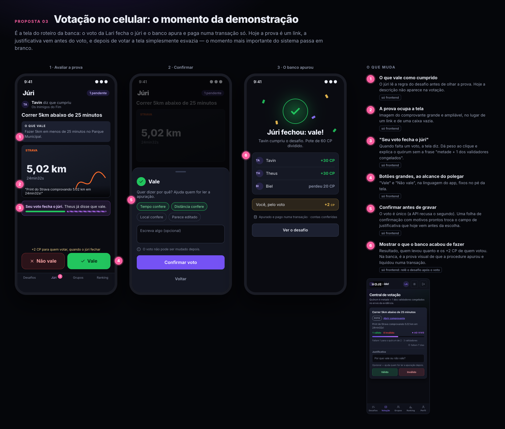
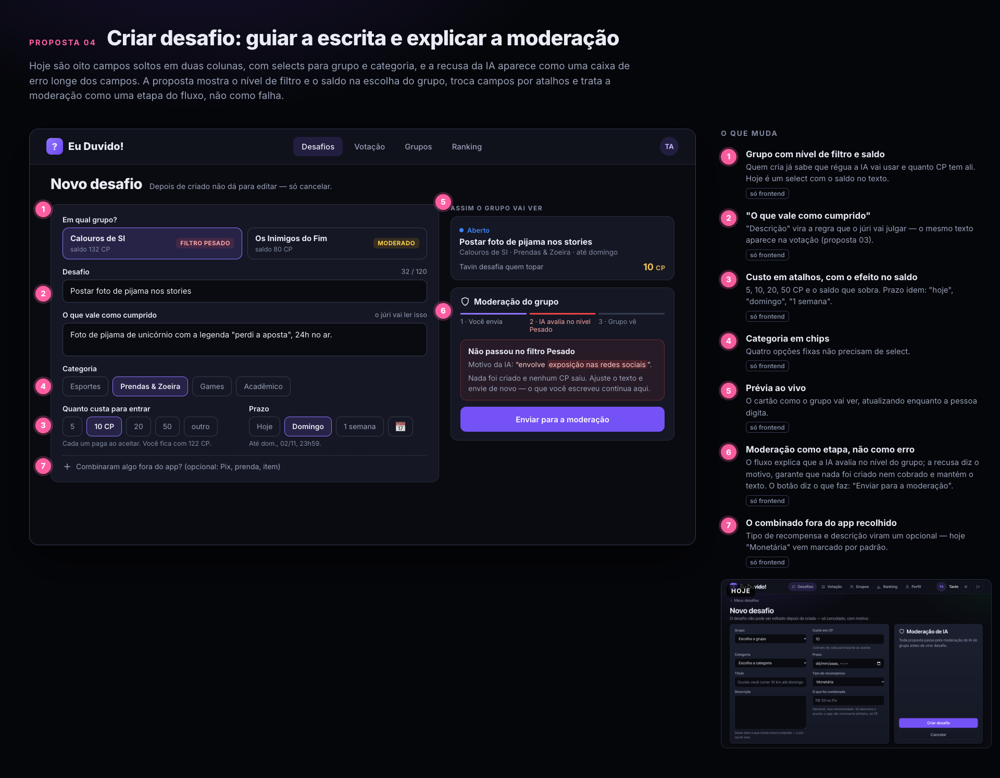
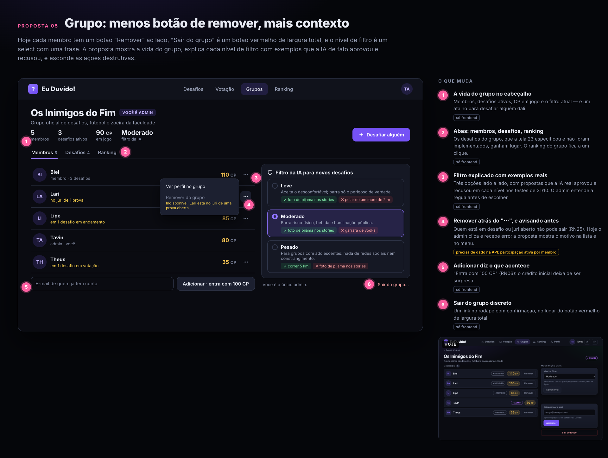
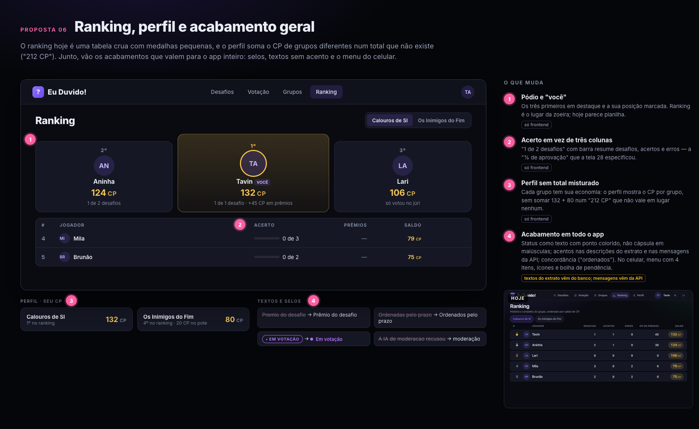

# Redesign de UI/UX (31/10/2026)

O PO achou a interface feia e desajeitada para a apresentação. Antes de mexer no
sistema, foram desenhadas seis propostas a partir das telas reais, com o seed da
demonstração. O PO aprovou todas, e cada uma virou uma issue e um commit da
mesma PR.

O que guiou as seis:

* **O app diz o que fazer agora.** Provas esperando voto, prova a enviar e
  desafio aberto ficam no topo, antes de qualquer lista.
* **Um número grande por vez.** O pote em CP é o destaque; status, papel e
  prazo deixam de ser cápsulas iguais competindo entre si.
* **Ação destrutiva fica longe do caminho.** Cancelar, remover e sair do grupo
  passam para menus e diálogos com confirmação.
* **Mostrar o que o banco fez.** Depois do voto que fecha o júri, a tela mostra
  a apuração e o pagamento que a procedure acabou de lançar.

## As propostas

| # | Proposta | Issue |
| --- | --- | --- |
| 01 | Início: o app diz o que fazer agora | [#44](https://github.com/SecreTavin/A3-banco-de-dados/issues/44) |
| 02 | Detalhe do desafio: quem ganha o quê e o que falta | [#45](https://github.com/SecreTavin/A3-banco-de-dados/issues/45) |
| 03 | Votação no celular e tela de resultado | [#46](https://github.com/SecreTavin/A3-banco-de-dados/issues/46) |
| 04 | Criar desafio: guiar a escrita e explicar a moderação | [#47](https://github.com/SecreTavin/A3-banco-de-dados/issues/47) |
| 05 | Grupo: contexto, filtro explicado e ações destrutivas escondidas | [#48](https://github.com/SecreTavin/A3-banco-de-dados/issues/48) |
| 06 | Ranking, perfil e acabamento geral | [#49](https://github.com/SecreTavin/A3-banco-de-dados/issues/49) |

## O que mudou fora do frontend

**Leituras novas na API**, todas em Dapper — o lado de escrita não mudou, nem
tabela, nem procedure:

| Endpoint | Campo novo | Para quê |
| --- | --- | --- |
| `GET /api/desafios` | meu papel, minha escolha, participantes, placar da prova no júri | "Sua vez" e o papel em cada linha |
| `GET /api/desafios/{id}` | criador; jurados de cada evidência (apelido e se já votou) | Júri com rosto, sem expor o voto |
| `GET /api/validacao/pendentes` | regra do desafio e desafiado | "O que vale" antes da prova |
| `GET /api/grupos/{id}` | desafios ativos, CP em jogo, pendências por membro | Avisar quem não pode sair (mesmas condições de `remover_membro`, RN25) |
| `GET /api/perfil` | grupo de cada lançamento | Extrato por grupo |

**Mensagens de erro da API com acento.** Só o texto mudou; os códigos
(`Desafio.DesafioRecusado` etc.) continuam iguais.

## Onde a implementação difere do desenho

* **Linha do tempo com quatro etapas** (aberto, em andamento, no júri,
  resultado), e não cinco: são os mesmos quatro momentos do ciclo de vida do
  desafio (RN03), na lista e no detalhe.
* **Exemplos de filtro testados de verdade.** O exemplo "correr 5 km" do nível
  `PESADO` não tinha sido testado quando a prancha foi desenhada; foi enviado à
  IA real antes de entrar na tela, e ela aprovou.
* **A página continua sem rolagem no desktop**, como decidido na PR #35: na tela
  inicial, só a lista de desafios rola por dentro.

## Como foi verificado

* Cada tela capturada no desktop (1366x768) e no celular (390x844), nos temas
  escuro e claro.
* Voto da demonstração feito pela tela nova; a tela de resultado mostrou Tavin
  +30, Theus +30 e Lari +2, os mesmos lançamentos que `apurar_votacao` gravou.
* Criação com a IA real: a proposta da foto de pijama foi recusada no filtro
  Pesado, com o motivo na tela, e "correr 5 km" foi aprovada e criada.
* Roteiros de ponta a ponta reexecutados com os seletores novos —
  [17 - Testes](../../05-qualidade/17-testes.md): tela 12/12, IA simulada 14/14,
  API 18/18 — e 147 testes da API.
