# Redesign mobile-first (10/11/2026)

Segunda rodada de redesign, feita para o pitch. A primeira (31/10) resolveu o
que cada tela diz; esta resolve **como o app parece e como se usa no celular**.
O celular passa a ser a base do layout, o desktop é a extensão, e o tema claro
vira o padrão. Nada mudou na API, nos hooks (`useXQuery`/`useXCommand`) nem no
banco: foi CSS, a moldura do app (`AppShell`) e três ajustes pontuais de tela.

## O que guiou

Referências consultadas antes de desenhar:

| Decisão | Referência |
| --- | --- |
| Navegação principal embaixo, ao alcance do polegar; inovação no conteúdo, não na navegação | [UXPin — Mobile navigation (2026)](https://www.uxpin.com/studio/blog/mobile-navigation-examples/), [Muzli — UI patterns that matter in 2026](https://muz.li/blog/whats-changing-in-mobile-app-design-ui-patterns-that-matter-in-2026/) |
| Tema por tokens, com `color-scheme` e o escuro redefinindo os mesmos nomes, nunca os componentes | [web.dev — Color themes with Baseline CSS](https://web.dev/articles/baseline-in-action-color-theme), [Chrome — Dark mode](https://developer.chrome.com/docs/modern-web-guidance/guides/visual-design/dark-mode) |
| Tipografia com personalidade: Bricolage Grotesque nos títulos, Figtree no texto | [Pimp my Type — Bricolage Grotesque pairings](https://pimpmytype.com/bricolage-grotesque-font-pairing/) |

O que o app tinha era a assinatura genérica de interface gerada: fundo escuro
com gradiente roxo, vidro fosco, Inter, cartões com gradiente e sombra. Para
ficar reconhecível num pitch, a identidade passou a ser:

* **Papel, tinta e dourado.** Fundo creme (`#f5f2ea`), texto em índigo-tinta
  (`#171336`), uma única cor de marca (índigo `#4433cc`) e o dourado reservado
  ao CP. No escuro, o índigo-preto da abertura (`#0d0b1c`) com texto cor de
  papel.
* **O desafio é um bilhete.** Cada linha da lista tem picote tracejado e um
  canhoto dourado com o pote. A prévia de "Criar desafio" é o mesmo bilhete.
* **O júri carimba.** "Venceu" é um carimbo inclinado; o resultado do voto
  surge como carimbo redondo; os botões "Vale" e "Não vale" são grandes, um por
  polegar.
* **A marca é "?!".** A dúvida e a prova, no mesmo quadrado índigo, com o "!"
  dourado. Vale como ícone do app, favicon e logo do login.

## Tokens e tipografia

Tudo em `apps/web/src/estilos/global.css`. O claro é o padrão em `:root`; o
escuro só redefine valores sob `:root[data-tema='escuro']`.

| Token | Claro | Escuro |
| --- | --- | --- |
| `--fundo` / `--superficie` | `#f5f2ea` / `#ffffff` | `#0d0b1c` / `#161331` |
| `--texto` / `--texto-suave` / `--texto-fraco` | `#171336` / `#4b4769` / `#7a7694` | `#f3efe6` / `#b5b1cb` / `#8784a6` |
| `--primaria` / `--primaria-forte` | `#4433cc` / `#3324a8` | `#6f5cf2` / `#8878ff` |
| `--cp` (texto) / `--cp-fundo` | `#8a5a00` / `#f6c453` | `#f6c453` / `#f6c453` |
| status (`--aberta`, `--em-andamento`, `--em-votacao`, `--cumpriu`, `--perdeu`) | azul, âmbar, violeta, verde e vermelho escurecidos para AA sobre creme | versões claras para AA sobre índigo |

Fontes servidas pelo próprio app (`@fontsource-variable`), sem depender de
rede na apresentação: **Bricolage Grotesque** (títulos, números de CP, marca)
e **Figtree** (texto). Corpo em 16px no celular, para o iOS não dar zoom nos
campos; alvos de toque de 44–48px.

O tema padrão passou a ser o claro: o script em `index.html` só aplica o escuro
se a pessoa escolheu no botão. O `prefers-color-scheme` do sistema deixou de
decidir, porque num pitch o resultado precisa ser previsível.

## Navegação

Um DOM só, dois arranjos (`AppShell.tsx` + `shell.module.css`):

* **Celular (até 1023px):** topo fino com a marca, o botão de tema e o avatar
  (que leva ao perfil); barra inferior fixa com Desafios, Votação, **Novo
  desafio** no centro (botão redondo levantado), Grupos e Ranking. A bolha de
  pendências fica na aba Votação. "Sair" mora no fim do perfil.
* **Desktop (1024px+):** a mesma barra vira coluna lateral, com "Novo desafio"
  no topo e o usuário, o tema e o sair no rodapé. O conteúdo rola por dentro;
  a janela não rola.

## Tela a tela

| Tela | O que mudou |
| --- | --- |
| Login | Lista de contas em linhas com avatar quadrado arredondado. No desktop, painel índigo à esquerda (o cenário da abertura) e a lista à direita. |
| Início | "Sua vez" em carrossel com o próximo cartão aparecendo na borda; abas "Ativos/Encerrados" em pílula de tinta; lista em bilhetes com picote e canhoto do pote. |
| Detalhe | Linha do tempo cabe inteira no celular; confronto empilhado com o pote como ficha redonda no meio; carimbo "venceu" no lado vencedor. |
| Criar | Grupo em cartões, categoria/custo/prazo em pílulas; a prévia é o bilhete; no desktop a lateral fica fixa ao rolar. |
| Votação | Regra do desafio com barra lateral índigo, prova grande, "Não vale" vazado em vermelho e "Vale" sólido em verde, 58px. Confirmação em folha que sobe. |
| Grupos | Cartões com nome em Bricolage, saldo em chip dourado e metadados em pílulas. No desktop a lista fica à esquerda e o formulário fixo à direita. |
| Grupo | Os quatro números viram fichas (2x2 no celular, 4 em linha no tablet); membros em lista contínua; filtro da IA com rádios de 20px. |
| Ranking | Pódio com o 1º em dourado e selo "1º"; seletor de grupo em pílulas roláveis. |
| Perfil | Identidade, fichas de histórico, saldo por grupo, extrato e "Sair da conta" (celular). |
| Abertura | Não mudou: é a marca. |

## Capturas

Celular (390x844, tema claro):

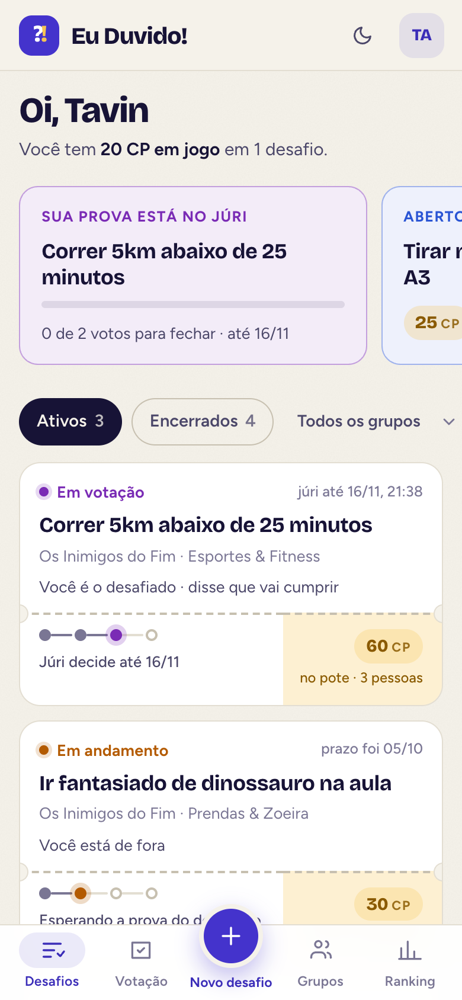
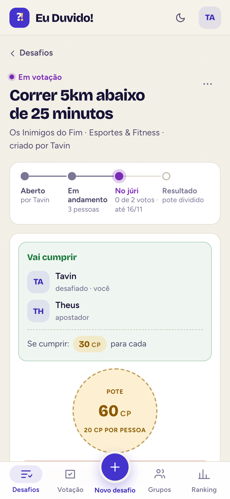
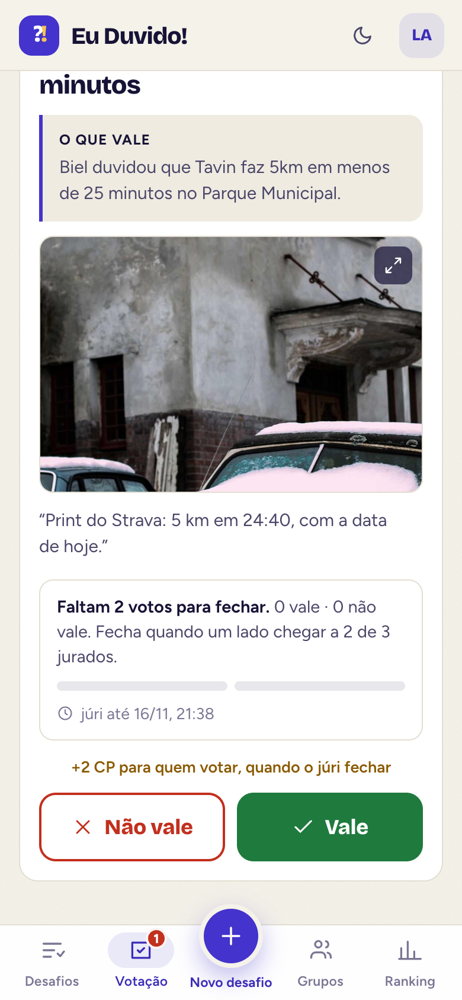
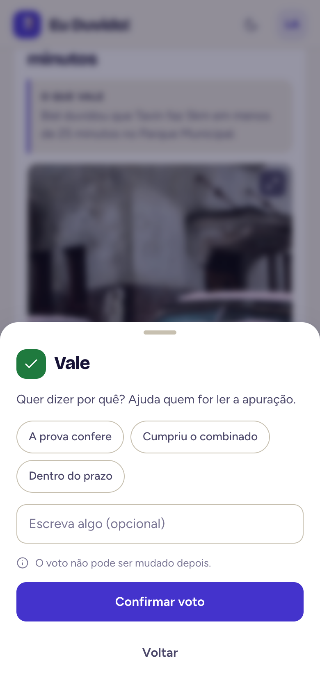
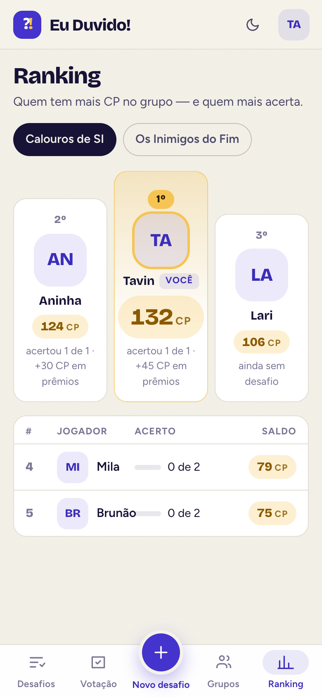
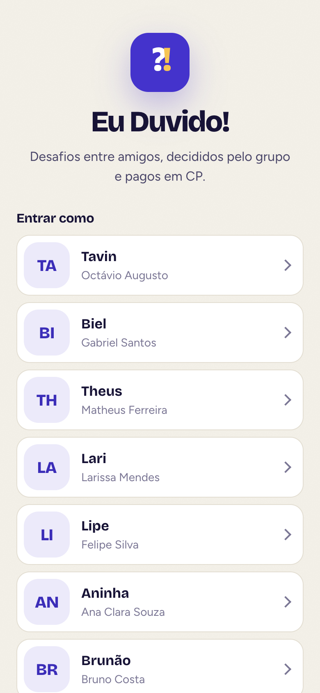

Celular, tema escuro:

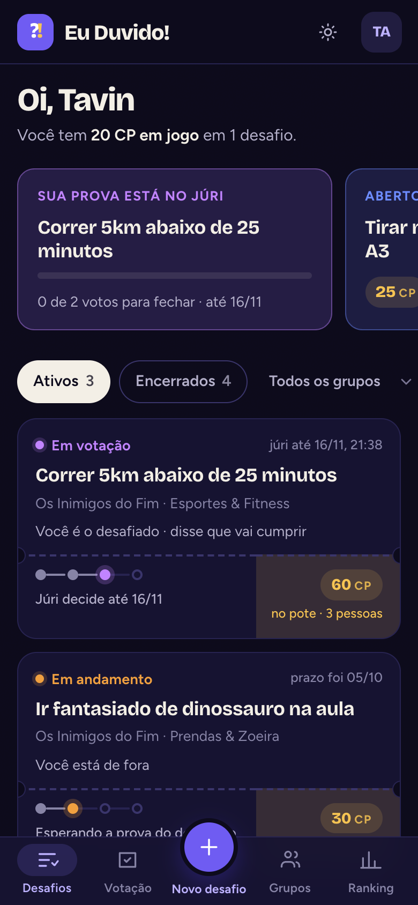
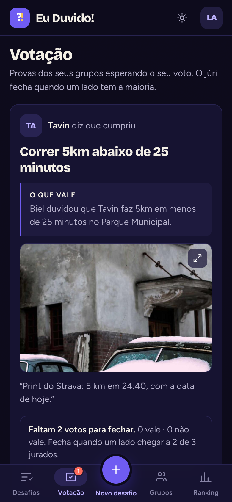

Desktop (1440x900):

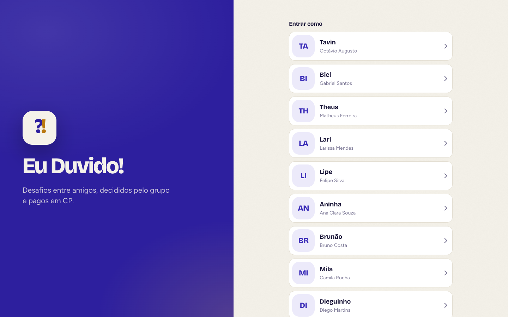
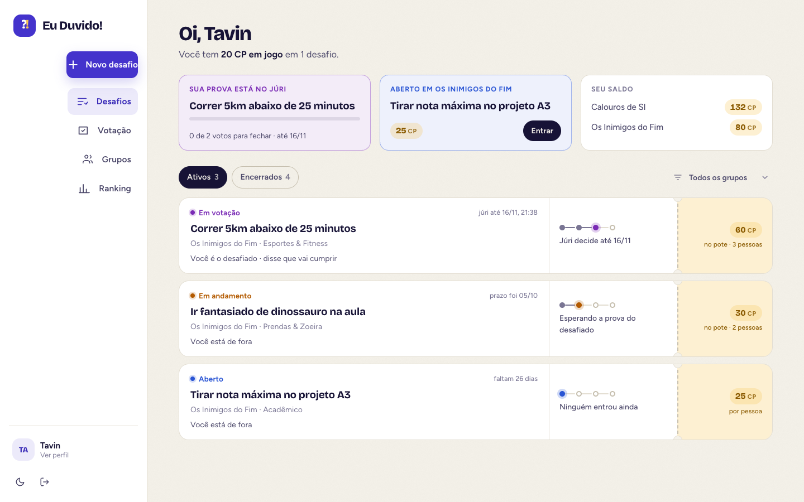
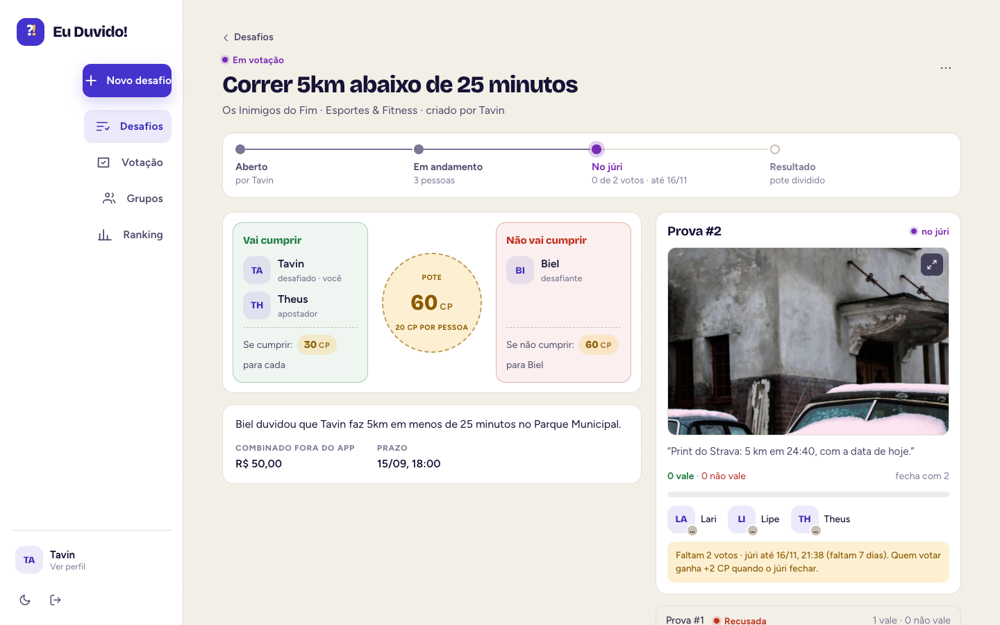
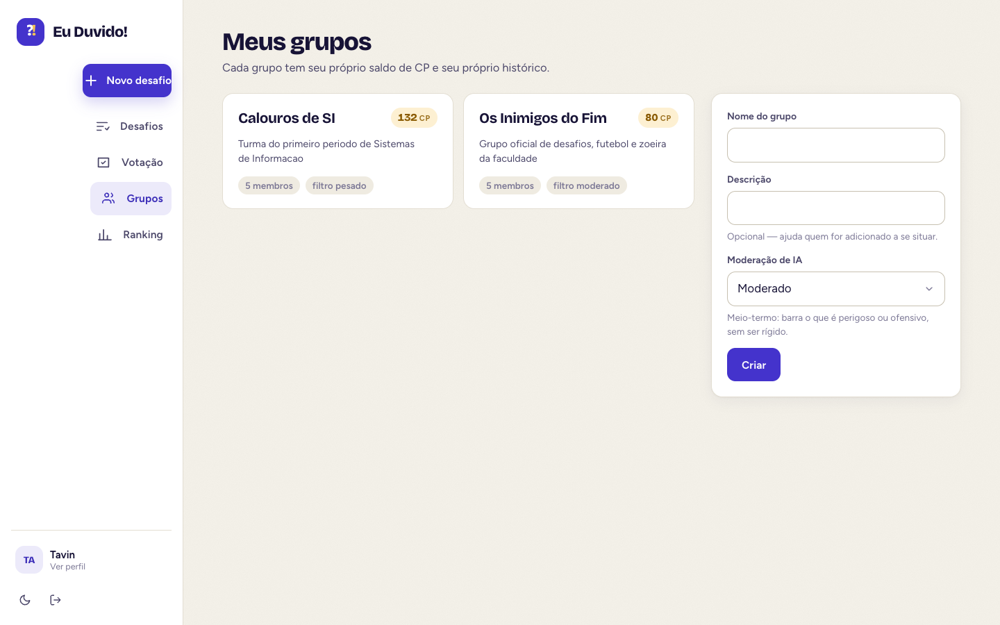
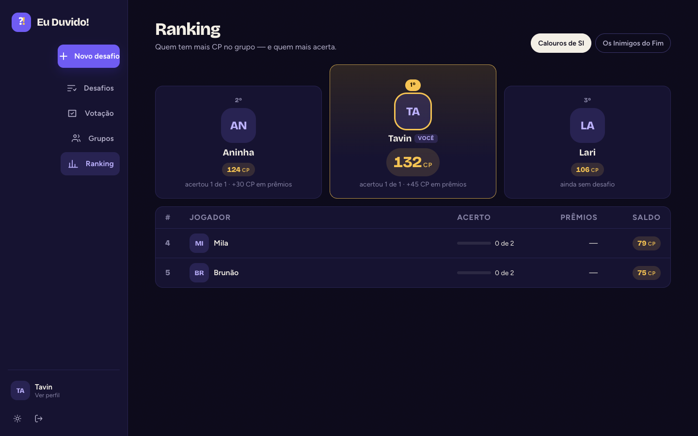

## Como foi verificado

* `tsc -b && vite build` sem erro; CSS final de 73 kB (14 kB gzip), fontes de
  150 kB no total.
* 71 capturas com Playwright e o Chrome do sistema: 390x844 e 1440x900, claro e
  escuro, todas as rotas autenticadas, mais o diálogo de confirmação do voto.
  Cada rodada foi lida tela a tela e as correções (barra inferior, colunas de
  grupos, rótulo do pote, linha do tempo) saíram dessa leitura.
* Os seletores dos roteiros de tela (`scripts/testes/roteiro-e2e-ui.mjs`)
  foram preservados: `[class*=conteudo]`, `[class*=lista]`, `role=tab`, os
  rótulos dos botões e o `aria-label` do botão de tema, que continua único no
  DOM.

## Pendente

* Rodar `roteiro-e2e-ui.mjs` e `roteiro-e2e-ia.mjs` de ponta a ponta antes do
  merge (escrevem no banco; não foram executados nesta rodada).
* Conferir no iPhone real: `100dvh`, área segura da barra inferior e o teclado
  sobre a folha de confirmação.
* Refazer as capturas dos documentos 22–30 com `scripts/telas/capturar-telas.mjs`.
