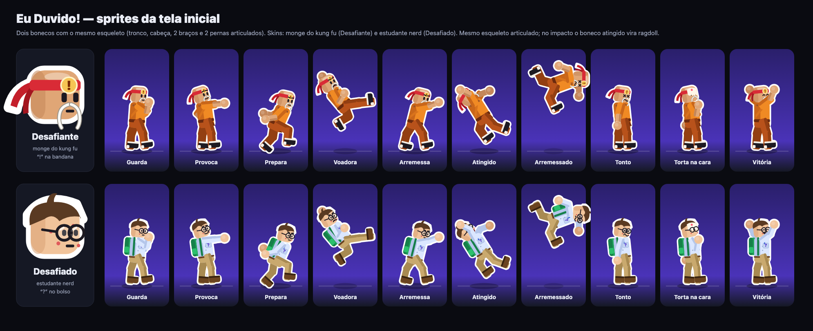
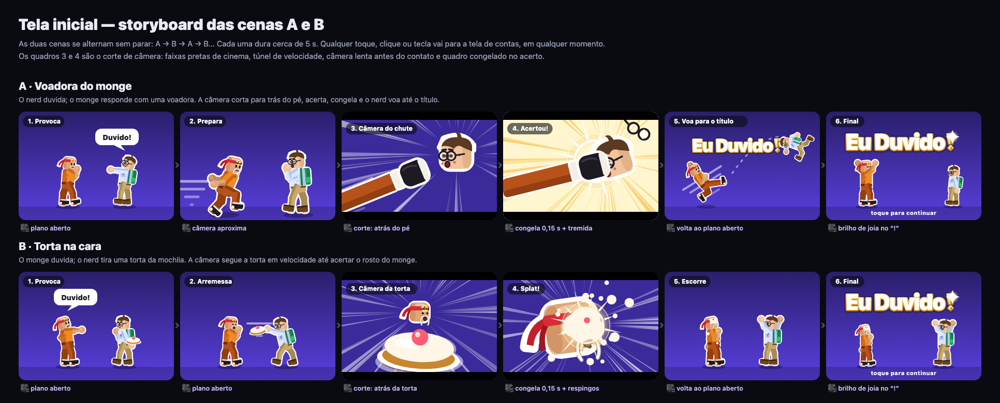
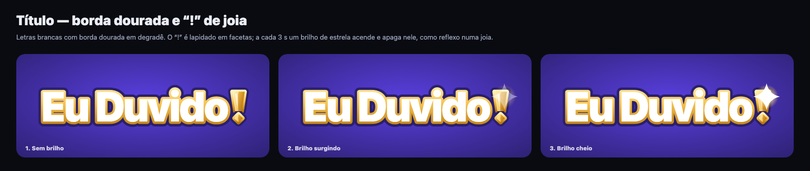
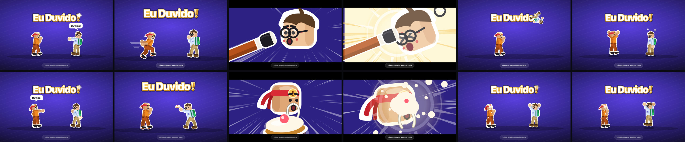
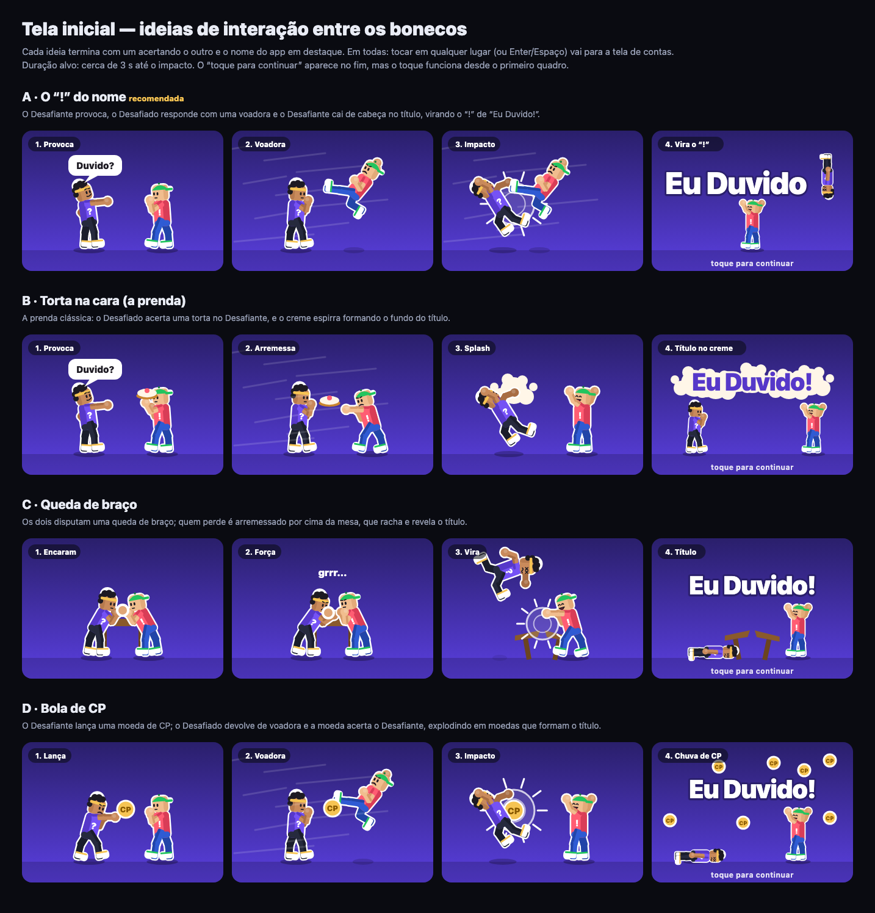

# Tela inicial: abertura animada (31/10/2026)

Pedido do PO depois da apresentação: uma tela antes da tela de contas, com uma
animação no estilo *ragdoll* em que um personagem acerta o outro e o golpe põe o
nome do app em destaque. Qualquer interação segue para a tela de contas.

O PO aprovou cada etapa antes da seguinte: primeiro os bonecos e as ideias,
depois as skins, as câmeras e o título, e por fim a implementação.

## Como chegamos aqui

| Rodada | O que foi mostrado | Decisão do PO |
| --- | --- | --- |
| 1 | Dois bonecos com 9 poses e quatro ideias de interação: voadora, torta, queda de braço e bola de CP ([imagem 2](#primeira-rodada-quatro-ideias)) | Ficar com a voadora e a torta, com câmera especial no golpe |
| 2 | Skins de monge e de nerd, storyboard das duas cenas e título dourado | Bigode do monge branco, "para exalar velhice e sabedoria" |
| 3 | A tela implementada, gravada em vídeo no desktop e no celular | Avaliação final antes de subir |

## Os personagens

| | Desafiante: monge do kung fu | Desafiado: estudante nerd |
| --- | --- | --- |
| Cabeça | Raspada, com reflexo; bigode branco, fino e longo | Cabelo com franja de lado e topete; óculos redondos e espinhas |
| Símbolo | "!" dourado na bandana vermelha | "?" no bolso da camisa social |
| Roupa | Hábito laranja, faixa marrom, contas, sapato de pano | Camisa social, calça cáqui, mochila verde |

Os dois têm o mesmo esqueleto: tronco, cabeça e dois braços e duas pernas com
duas articulações cada. Uma pose é só um conjunto de ângulos, e a animação passa
de uma pose para outra. Os sprites abaixo foram gerados pelo mesmo código que
desenha a tela.

## As cenas

As duas cenas se alternam sem parar, cerca de 5,6 s cada: A, B, A, B…

| Momento | A: voadora do monge | B: torta na cara |
| --- | --- | --- |
| Provocação | O nerd diz "Duvido!"; a câmera se aproxima do monge, que se prepara | O monge diz "Duvido!"; o nerd tira a torta da mochila e arremessa |
| Corte de câmera | Atrás do pé do monge: faixas de cinema, túnel de velocidade, câmera lenta antes do contato | Atrás da torta: o rosto do monge cresce até encher a tela |
| Acerto | Quadro congelado com clarão, onda de choque, tremida e os óculos voando | "Splat" congelado, com o creme abrindo e respingando |
| Ênfase no nome | O nerd voa girando, bate no "!" do título, que treme e brilha, e cai tonto | O título pulsa e brilha; o creme escorre do rosto do monge |
| Final | Monge comemora; nerd tonto com estrelas girando | Nerd comemora; monge de cara melada |

## O título

As letras são brancas com borda dourada em degradê. O "!" é desenhado como uma
joia, com facetas claras e escuras. A cada 3 s, um brilho de estrela acende e
apaga sobre ele. No golpe de cada cena, o brilho acende de novo.

## Como ficou implementada

Quadros reais da tela em 1280x800. Na primeira linha está a cena A: provoca,
prepara, câmera do chute, acerto, voo até o "!" e final. Na segunda linha está a
cena B: provoca, arremesso, câmera da torta, "splat", creme escorrendo e final.

| Regra | Como funciona |
| --- | --- |
| Quando aparece | Em toda carga da página, logado ou não. A navegação dentro do app não volta a ela |
| Como seguir | Qualquer toque, clique ou tecla, em qualquer momento da animação |
| Para onde vai | Para a tela de contas (`/login`). Quem já está logado segue para `/desafios`, e um link direto (ex.: `/grupos/2`) abre a tela pedida |
| Convite | "Toque para continuar" no celular e "Clique ou aperte qualquer tecla" no computador, pulsando |
| Menos movimento | Quem ativou "reduzir movimento" no sistema vê o quadro final, parado |
| Tema | A abertura tem cenário próprio, igual no tema claro e no escuro |

**Uma função do tempo.** `quadro(tempo, palco)` devolve o SVG do instante pedido.
Não existe estado de física guardado entre quadros. O efeito *ragdoll* é uma
oscilação amortecida em cada articulação, calculada a partir do instante do
golpe, com amplitude, frequência e fase próprias. Por isso a animação não acumula
erro, o laço é infinito sem deriva e o quadro parado é só um instante fixo.

**Sem dependência nova.** O desenho é SVG em string, escrito direto no `<g>` da
cena a cada `requestAnimationFrame`. Passar 60 quadros por segundo pela
reconciliação do React não traria nada. Código em
`apps/web/src/features/abertura/`:

| Arquivo | Papel |
| --- | --- |
| `desenho/boneco.ts` | Esqueleto, poses e as duas skins |
| `desenho/cena.ts` | Título com a joia, túnel de velocidade, impacto, torta, creme e pé em primeiro plano |
| `desenho/roteiro.ts` | As cenas A e B no tempo, os cortes de câmera e o ragdoll |
| `views/AberturaView.tsx` | Mede a tela, anima e segue com qualquer toque ou tecla |

## Como foi verificado

* A animação foi gravada quadro a quadro, com o relógio do navegador controlado,
  em 1280x800 e 390x844. Os quadros foram conferidos contra o storyboard.
* O cenário U13 do [roteiro de tela](../../../05-qualidade/17-testes.md) confere
  quatro comportamentos:
  * a cena muda ao longo do tempo;
  * uma tecla leva a `/login`;
  * um clique de quem está logado leva a `/desafios`;
  * com "reduzir movimento", a cena fica parada.
* Os roteiros de tela (13/13) e de IA simulada (14/14) passam pela abertura a
  cada carga de página.

## Primeira rodada: quatro ideias

As skins desta imagem ainda são as da primeira versão. O PO escolheu as ideias A
e B.

