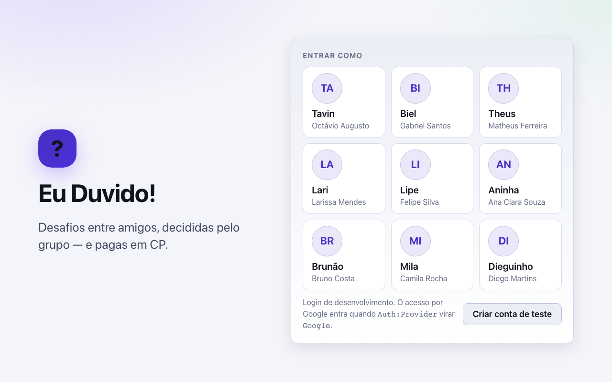

# 22 - Tela: Autenticação

## Objetivo
Cadastro e login de usuários via Google (RF01).

## Seções principais
- **Login:** OAuth com Google — sem senha própria no app
- **Cadastro:** nome, email e foto vêm do Google; usuário define o `apelido` e informa a `data_nascimento` no primeiro acesso (idade mínima de 16 anos, RN26)

## Como ficou implementada

| Especificado | Implementado |
| --- | --- |
| Login com Google | Login de desenvolvimento: escolhe-se um usuário do seed. O Google entra quando `Auth:Provider` virar `Google` |
| Cadastro com apelido e data de nascimento | **Criar conta de teste** pede nome, e-mail, apelido e data de nascimento; menor de 16 anos é recusado (RN26, trigger `trg_usuario_idade_minima`) |

Antes desta tela vem a abertura animada ([30 - Abertura](30-tela-abertura.md)), em toda carga da página.

*Captura do sistema rodando com o seed da demonstração, gerada por [`scripts/telas/capturar-telas.mjs`](../../../scripts/telas/capturar-telas.mjs).*

## Dados (origem: `usuario`)
`nome`, `email` (UNIQUE), `apelido`, `avatar_url`, `data_nascimento`, `data_cadastro`

## Decisões (validado com o time)
- Login é exclusivamente via Google — recuperação de senha e regras de validação de senha saem de escopo (não existe senha própria no sistema).
- `apelido` não precisa ser UNIQUE (pode repetir entre usuários); a distinção entre contas passa a ser feita pelo `email`/id do Google, não pelo apelido.

## Resolvido na arquitetura
- **Sem senha no banco:** o login é externo, então `usuario` não tem `senha_hash` nem tabela de credencial; a identidade é o `email` (RN05).
- **Avatar:** `usuario.avatar_url` existe e é preenchido com a foto do Google no primeiro login — a tela de cadastro não pede foto ao usuário.
- **Idade mínima:** o trigger `trg_usuario_idade_minima` recusa no banco o cadastro de menor de 16 anos (RN26).

## TODOs para validação com o time
Nenhum pendente — ver **Resolvido na arquitetura**.
