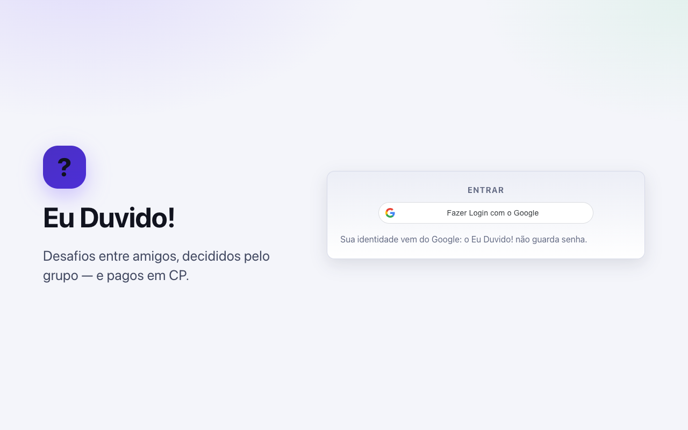

# 22 - Tela: Autenticação

## Objetivo
Cadastro e login de usuários via Google (RF01).

## Seções principais
- **Login:** OAuth com Google — sem senha própria no app
- **Cadastro:** nome, email e foto vêm do Google; usuário define o `apelido` e informa a `data_nascimento` no primeiro acesso (idade mínima de 16 anos, RN26)

## Como ficou implementada

| Especificado | Implementado (20/11/2026, [ADR 0021](../../02-arquitetura/adr/0021-login-exclusivo-google.md)) |
| --- | --- |
| Login com Google | Botão oficial **Entrar com Google**. O ID token do Google vai para a API, que o valida no servidor (assinatura, Client ID, validade, e-mail verificado) e emite a sessão. Não existe mais login de desenvolvimento |
| Cadastro com apelido e data de nascimento | No primeiro acesso aparece **Complete seu cadastro**, com nome, e-mail e foto vindos do Google. A pessoa informa apelido e data de nascimento e clica em **Criar conta e entrar**. Menor de 16 anos é recusado e nada é gravado (RN26, trigger `trg_usuario_idade_minima`) |
| Sem configuração | Sem `GOOGLE_CLIENT_ID`, a tela avisa que o login não foi configurado, e a API responde 503 |

**Contrato da API:**

* `GET /api/auth/configuracao`: devolve o Client ID para o botão.
* `POST /api/auth/google`: valida o ID token. Quem já tem conta recebe a sessão. Quem não tem recebe um token de cadastro de 15 minutos, com audiência própria, que não abre nenhum outro endpoint.
* `POST /api/auth/cadastro`: completa o cadastro com esse token, o apelido e a data de nascimento.

É a primeira tela do app: a abertura animada ([30 - Abertura](30-tela-abertura.md)) foi removida em 20/11/2026.

*Captura do sistema rodando com o seed da demonstração, gerada por [`scripts/telas/capturar-telas.mjs`](../../../scripts/telas/capturar-telas.mjs).*

## Dados (origem: `usuario`)
`nome`, `email` (UNIQUE), `apelido`, `avatar_url`, `data_nascimento`, `data_cadastro`

## Decisões (validado com o time)
- Login é exclusivamente via Google — recuperação de senha e regras de validação de senha saem de escopo (não existe senha própria no sistema).
- `apelido` não é UNIQUE e pode repetir entre usuários. Quem identifica o usuário é o `id_usuario` (decisão do PO em 09/11/2026); ranking, pódio, perfil e júri usam o id.

## Resolvido na arquitetura
- **Sem senha no banco:** o login é externo, então `usuario` não tem `senha_hash` nem tabela de credencial; a identidade é o `email` (RN05).
- **Avatar:** `usuario.avatar_url` existe e é preenchido com a foto do Google no primeiro login — a tela de cadastro não pede foto ao usuário.
- **Idade mínima:** o trigger `trg_usuario_idade_minima` recusa no banco o cadastro de menor de 16 anos (RN26).

## TODOs para validação com o time
Nenhum pendente — ver **Resolvido na arquitetura**.
