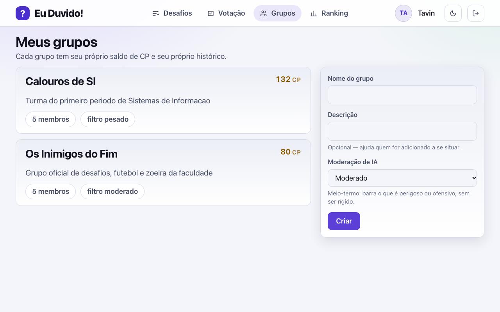
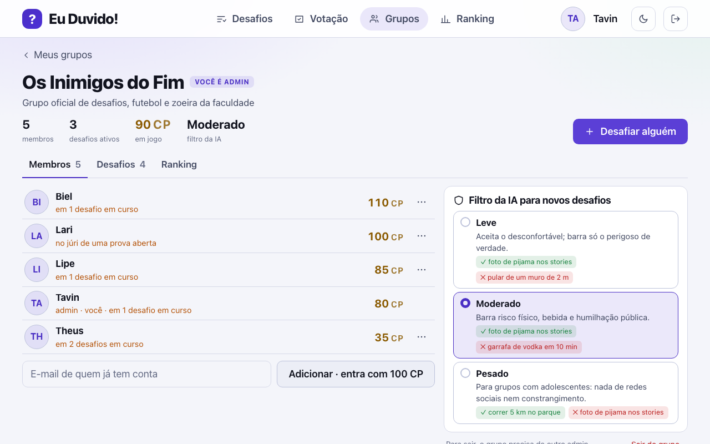

# 23 - Tela: Meus Grupos

## Objetivo
Gestão de grupos privados de amigos (RF02).

## Seções principais
- **Lista de grupos:** nome, descrição, nº de membros, meu saldo de CP no grupo
- **Criar grupo:** nome, descrição
- **Adicionar membro:** o `ADMIN` adiciona ao grupo um usuário já cadastrado
- **Detalhe do grupo:** lista de membros (com papel `ADMIN`/`MEMBRO` e saldo de CP), desafios do grupo
- **Nível de filtro:** `LEVE`/`MODERADO`/`PESADO`, alterável só pelo `ADMIN` (RN27)

## Como ficou implementada

| Especificado | Implementado |
| --- | --- |
| Lista de grupos com saldo | Sim |
| Criar grupo | Sim |
| Adicionar membro (só `ADMIN`) | Sim, por e-mail de usuário já cadastrado; entra com 100 CP (RN06) |
| Detalhe: membros com papel e saldo | Sim. **Remover do grupo…** fica no menu "⋯" do membro, só para o `ADMIN`, e **Sair do grupo…** no fim da página; os dois pedem confirmação e avisam quem tem desafio ou júri em aberto (RN25, `SAIDA_GRUPO`) |
| Detalhe: desafios do grupo | Sim, na aba **Desafios**; a aba **Ranking** leva ao ranking do grupo |
| Nível de filtro (só `ADMIN`) | Sim, em *Filtro da IA para novos desafios*, com um exemplo aprovado e um recusado por nível (RN27) |

*Captura do sistema rodando com o seed da demonstração, gerada por [`scripts/telas/capturar-telas.mjs`](../../../scripts/telas/capturar-telas.mjs).*

## Dados (origem: `grupo_amigos`, `membro_grupo`)
`nome`, `descricao`, `id_criador`, `nivel_filtro`, `data_criacao` / `papel`, `saldo_cp`, `data_entrada`

## Decisões (validado com o time)
- Remoção de membro: qualquer `ADMIN` pode remover (o criador do grupo já é `ADMIN` por padrão).
- Edição/exclusão do grupo: restrita a `ADMIN`/criador.
- Usuário pode sair do grupo por conta própria.
- **Desktop (>= 1100px):** o formulário de criar grupo fica sempre visível à direita da lista (no celular continua atrás do botão "Criar grupo"). No detalhe, os membros ficam à esquerda e moderação, convite e saída à direita.

## Resolvido na arquitetura
- **Saldo de CP na tela:** `membro_grupo.saldo_cp` é exibido tanto na lista de grupos (meu saldo) quanto na lista de membros. Todo membro entra com 100 CP (RN06) e o saldo nunca fica negativo (RN08); a fonte da verdade é o ledger `transacao_cp` ([ADR 0007](../../02-arquitetura/adr/0007-ledger-append-only.md)).

## TODOs para validação com o time
Nenhum pendente — ver **Resolvido na arquitetura**.
