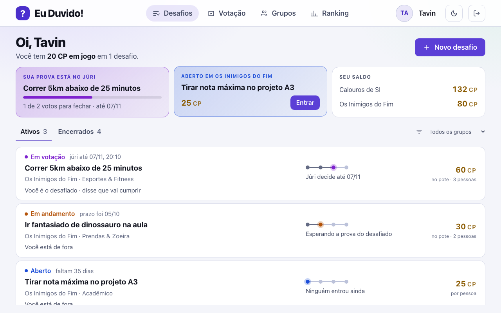

# 24 - Tela: Meus desafios

## Objetivo
Dashboard principal do usuário com os desafios em que está envolvido (RF04, RF05, RF08).

## Seções principais
- **Filtro por status:** `ABERTA`, `EM_ANDAMENTO`, `EM_VOTACAO`, `FINALIZADA_CUMPRIU`, `FINALIZADA_PERDEU`, `CANCELADA` (RN03)
- **Cards de desafio:** título, categoria, grupo, custo em CP, recompensa, prazo (`data_limite`)
- **Separação:** desafios que criei vs. que participo
- **CTA direto** para a Central de Votação em desafios `EM_VOTACAO` (ex: "Cumpra agora!")

## Como ficou implementada

| Especificado | Implementado |
| --- | --- |
| Filtro pelos seis status | Em duas abas, **Ativos** e **Encerrados**, com filtro por grupo; o status aparece em cada linha |
| Cartão com título, grupo, categoria, custo, recompensa e prazo | Sim, numa linha com a etapa do desafio (aberto, em andamento, no júri, resultado) |
| Separar "criei" de "participo" | Sim; cada linha diz o meu papel no desafio |
| Atalho para votação em `EM_VOTACAO` | Sim, no bloco **Sua vez** do topo, com o botão **Votar** |

O redesign de UI/UX ([proposta 01](../propostas/README.md)) pôs no topo o que
pede ação agora: prova esperando voto, prova a enviar e desafio aberto.

*Captura do sistema rodando com o seed da demonstração, gerada por [`scripts/telas/capturar-telas.mjs`](../../../scripts/telas/capturar-telas.mjs).*

## Dados (origem: `desafio`, `participante_desafio`)
`titulo`, `status`, `valor_cp`, `tipo_recompensa`, `descricao_recompensa`, `data_limite` / `papel_desafio`, `escolha`

## Decisões (validado com o time)
- Ordenação padrão: prazo mais próximo primeiro (lista com prioridade por `data_limite`).
- Desafios `EM_VOTACAO` mostram um CTA direto para a Central de Votação.
- **Desktop (>= 1100px):** os cards de "Criei" e "Participo" ficam numa única grade de 3 colunas, sem rolagem da página; a separação vira dois contadores ("Criei · N", "Participo · N") ao lado do filtro. No celular a separação em seções continua.

## Resolvido na arquitetura
- **Custo em CP no card:** cada card mostra `desafio.valor_cp` — o custo fixo por participante (RN07). A `descricao_recompensa` aparece no card apenas como texto descritivo do que foi combinado fora do app ([ADR 0006](../../02-arquitetura/adr/0006-cp-como-moeda.md)).
- **Cancelamento automático:** desafio que chega à `data_limite` ainda `ABERTA` é cancelado por um `BackgroundService` (RN21), e some dos filtros ativos da tela como `CANCELADA`.

## TODOs para validação com o time
Nenhum pendente — ver **Resolvido na arquitetura**.
