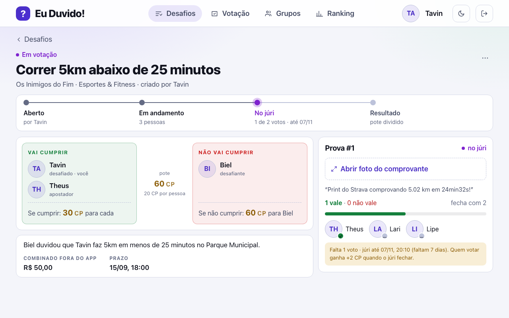

# 26 - Tela: Detalhe do desafio

## Objetivo
Visão completa de um desafio específica: participantes, evidências e resultado.

## Seções principais
- **Cabeçalho:** status, prazo, custo em CP e pote em jogo, recompensa
- **Participantes:** lista com papel e escolha
- **Evidências:** mídia (`FOTO`/`VIDEO`/`LINK`/`TEXTO`), comprovante, comentário, status da evidência — exibidas em linha do tempo (até 5 por desafio)
- **Envio de evidência** (RF06) — nova evidência sequencial permitida se a anterior for recusada pelo júri
- **Cancelamento**, quando cabível, com motivo obrigatório
- **Resultado final** quando o desafio é encerrado

## Como ficou implementada

| Especificado | Implementado |
| --- | --- |
| Cabeçalho com status, custo, pote, recompensa e prazo | Sim, com a linha do tempo das etapas |
| Participantes com papel e escolha | Sim, em confronto: quem diz que cumpre contra quem diz que não, e quanto cada um ganha. Quem ainda não participa de desafio `ABERTA` escolhe o papel e clica em **Entrar como…** |
| Evidências com status e votos | Sim, com quórum, prazo e os jurados (quem já votou, sem mostrar o voto) |
| Envio de evidência | Sim, pelo `DESAFIADO`, como **URL** do comprovante. Upload direto de arquivo não foi implementado ([19 - Limitações](../../06-encerramento/19-limitacoes-e-melhorias.md)) |
| Cancelamento com motivo | Sim, no menu "⋯" com diálogo de confirmação, só para quem criou e enquanto não encerrado |

*Captura do sistema rodando com o seed da demonstração, gerada por [`scripts/telas/capturar-telas.mjs`](../../../scripts/telas/capturar-telas.mjs).*

## Dados (origem: `desafio`, `participante_desafio`, `evidencia`)
`status`, `valor_cp`, `data_limite`, `motivo_cancelamento`, `data_encerramento` / `papel_desafio`, `escolha` / `ordem`, `tipo_midia`, `url_comprovante`, `comentario`, `status`, `data_envio`, `data_limite_votacao`, `data_apuracao`

## Decisões (validado com o time)
- Transição `EM_VOTACAO` → `FINALIZADA_CUMPRIU`/`FINALIZADA_PERDEU` depende da validação por quórum a cada etapa (quórum = metade + 1 dos validadores, ver [27](27-tela-central-votacao.md)).
- Cancelamento: o criador pode cancelar o desafio a qualquer momento após criado; a partir do início da validação, é obrigatório informar o motivo, que deve ser aprovado por pelo menos metade dos integrantes (`APOSTADOR` não conta para esse quórum).
- Evidências: exibidas em linha do tempo; o apostador pode enviar uma nova evidência sequencial se o júri recusar a anterior, até no máximo 5 evidências por desafio. A partir de 3 evidências recusadas, o apostador perde o desafio.

## Resolvido na arquitetura
- **Status da evidência existe no banco:** `evidencia.status` com `EM_VOTACAO`/`ACEITA`/`RECUSADA`/`EXPIRADA` (constraint `chk_evidencia_status`, RN13), escrito pela procedure de apuração. Com isso, a regra "3 recusadas e o desafiado perde" passa a ser **derivável do banco** — basta contar as evidências `RECUSADA` do desafio, sem estado paralelo na aplicação (RN10).
- **Limite de 5 evidências:** garantido por `chk_evidencia_ordem` (`ordem BETWEEN 1 AND 5`) e `unq_evidencia_ordem` (`UNIQUE (id_desafio, ordem)`) — a linha de tempo não aceita uma sexta evidência nem duas na mesma posição (RN10).
- **Cancelamento com motivo:** `chk_desafio_cancelamento` recusa no banco qualquer desafio `CANCELADA` sem `motivo_cancelamento`. O cancelamento é executado pela procedure `cancelar_desafio`, que **estorna o CP** de todos os participantes com um lançamento novo no ledger — nunca apagando o original (RN12, RN24, [ADR 0007](../../02-arquitetura/adr/0007-ledger-append-only.md)).
- **Mídia da evidência:** a linha em `evidencia` só é criada **após** o storage confirmar o upload, para o júri nunca votar em evidência inexistente (RN22, [ADR 0009](../../02-arquitetura/adr/0009-armazenamento-de-midia-r2.md)). **Estado atual:** o upload direto não foi implementado; a tela recebe a URL do comprovante e a evidência é criada com ela.

## TODOs para validação com o time
Nenhum pendente — ver **Resolvido na arquitetura**.
