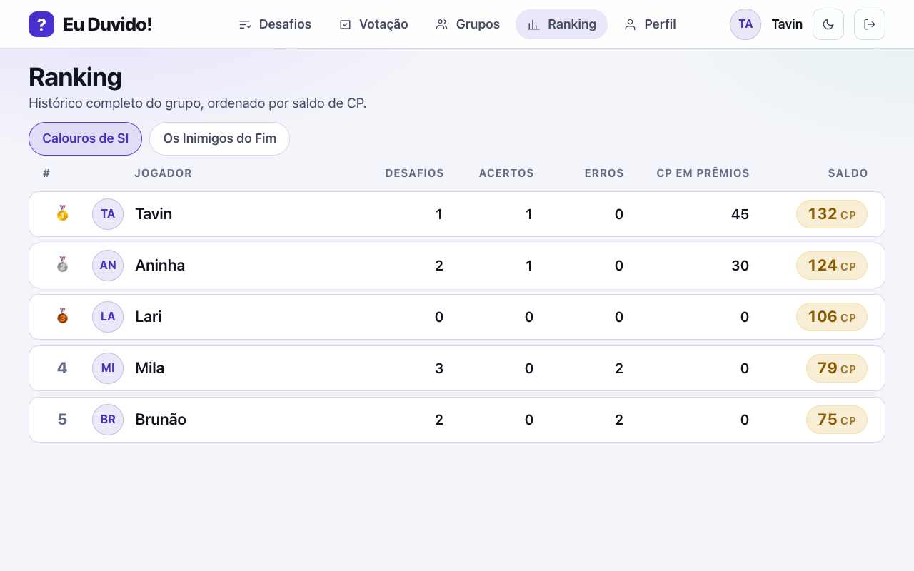

# 28 - Tela: Ranking

## Objetivo
Ranking de maiores desafios e apuração de resultados (RF08).

## Seções principais
- **Ranking por grupo** (histórico completo — cada grupo tem seu próprio histórico de ações)
- **Maiores desafios** (por pote em CP)
- **% de aprovação** e cumpridas vs. perdidas

## Como ficou implementada

| Especificado | Implementado |
| --- | --- |
| Ranking por grupo, com histórico completo | Sim: desafios, acertos, erros, CP em prêmios e saldo |
| Maiores desafios por pote | **Não na tela.** Existe como consulta Q3 em [16 - Consultas SQL](../../03-banco-de-dados/implementacao/16-consultas-sql.md) |
| % de aprovação, cumpridas × perdidas | **Não na tela.** Acertos e erros aparecem por jogador |

*Captura do sistema rodando com o seed da demonstração, gerada por [`scripts/telas/capturar-telas.mjs`](../../../scripts/telas/capturar-telas.mjs).*

## Dados (origem: queries analíticas sobre `desafio`, `participante_desafio`, `jurado_evidencia`, `transacao_cp`, `membro_grupo`)
Baseado em [analytical_queries.sql](../../../database/scripts/queries/analytical_queries.sql) — `valor_cp`, `saldo_cp`, `percentual_aprovacao`, contagem de votos favoráveis/contra.

## Decisões (validado com o time)
- Período do ranking: histórico completo, por grupo (cada grupo tem seu próprio histórico completo de ações).

## Resolvido na arquitetura
- **Prendas sem valor numérico (TODO anterior):** resolvido pela adoção do **CP como moeda única**. **Todo** desafio custa CP, inclusive os de prenda (`desafio.valor_cp`, RN07) — então desafio de prenda e desafio de dinheiro entram no ranking na **mesma coluna**, comparáveis entre si, e nenhuma fica de fora. O `valor_monetario` deixou de ser critério: é apenas descritivo ([ADR 0006](../../02-arquitetura/adr/0006-cp-como-moeda.md), RN02).
- **Ranking por grupo:** alimentado pela query **Q2** de [analytical_queries.sql](../../../database/scripts/queries/analytical_queries.sql) (histórico completo de cada membro no grupo).
- **"Maiores desafios":** deixou de ser ranqueado por valor monetário — agora é por **pote em CP** (`valor_cp × número de participantes`), pela query **Q3**.

## TODOs para validação com o time
Nenhum pendente — ver **Resolvido na arquitetura**.
