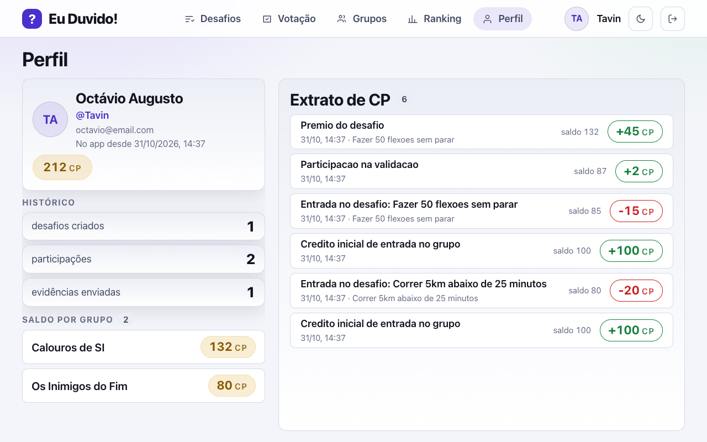

# 29 - Tela: Perfil

## Objetivo
Dados do usuário e histórico pessoal. Confirmado no escopo do MVP.

## Seções principais
- **Dados do usuário:** nome, apelido, email, avatar/foto, data de cadastro
- **Edição de perfil:** nome e apelido
- **Saldo de CP por grupo** e extrato de movimentações
- **Histórico:** desafios criados, participações, evidências enviadas

## Como ficou implementada

| Especificado | Implementado |
| --- | --- |
| Dados do usuário | Sim (nome, apelido, e-mail, data de cadastro) |
| Edição de nome e apelido | **Não implementada** |
| Saldo por grupo e extrato | Sim; o extrato lê o ledger `transacao_cp` com saldo acumulado |
| Histórico: criados, participações, evidências | Sim |

*Captura do sistema rodando com o seed da demonstração, gerada por [`scripts/telas/capturar-telas.mjs`](../../../scripts/telas/capturar-telas.mjs).*

## Dados (origem: `usuario`, `desafio`, `participante_desafio`, `evidencia`, `membro_grupo`, `transacao_cp`)
`nome`, `apelido`, `email`, `avatar_url`, `data_cadastro` / `saldo_cp` / `tipo`, `valor`, `descricao`, `data_lancamento`

## Decisões (validado com o time)
- Tela entra no escopo do MVP.
- Avatar/foto é necessário.
- Edição de perfil faz parte desta tela.

## Resolvido na arquitetura
- **Falta de coluna de avatar (TODO anterior):** adicionada `usuario.avatar_url`, preenchida com a **foto do Google** no primeiro login — o usuário já entra no app com avatar, sem passo extra de cadastro.
- **Upload de avatar próprio ficou fora do MVP:** a edição de perfil cobre nome e apelido; trocar a foto por upload exigiria fluxo de mídia e moderação, e não entrou nesta versão. A coluna já comporta a evolução sem mudança de schema.
- **Saldo e extrato de CP:** o perfil mostra o `saldo_cp` do usuário **em cada grupo** (`membro_grupo`) e o extrato de movimentações vindo do ledger `transacao_cp`, pela query **Q5** de [analytical_queries.sql](../../../database/scripts/queries/analytical_queries.sql). O saldo é materializado e reconciliável contra o ledger ([ADR 0007](../../02-arquitetura/adr/0007-ledger-append-only.md)).

## TODOs para validação com o time
Nenhum pendente — ver **Resolvido na arquitetura**.
