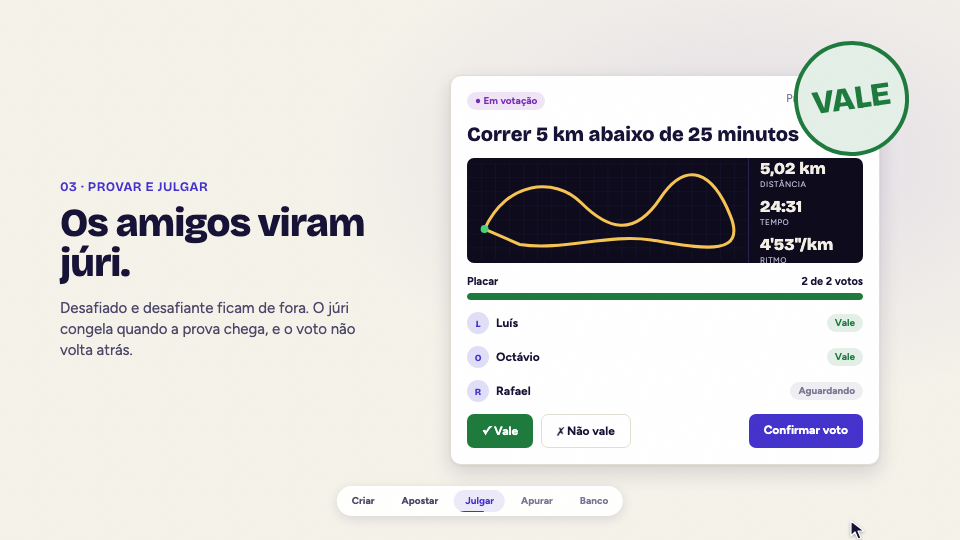
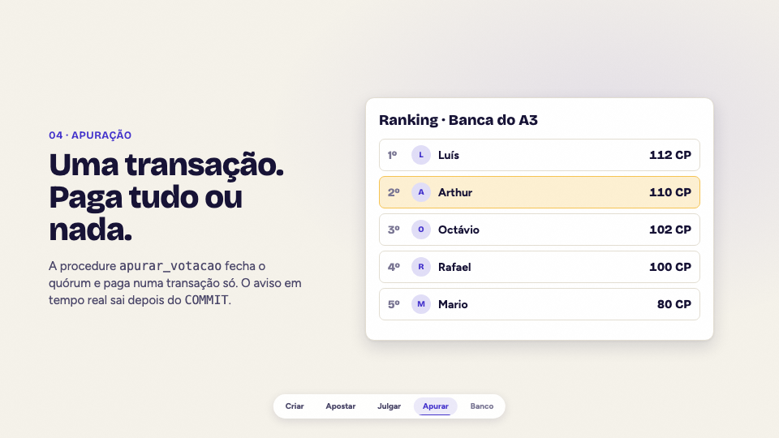

# Vídeo de demonstração

| Campo | Valor |
| --- | --- |
| **Versão** | 24/11/2026 |
| **Arquivo** | [`video/eu-duvido-demo.mp4`](video/eu-duvido-demo.mp4) (1920x1080, 30 fps, 63 s, 10 MB) |
| **Onde passa** | Na abertura da Banca Final, antes do slide 1 ([roteiro dos slides](roteiro-dos-slides.md)) |
| **Código** | [`apps/video/`](../../apps/video/README.md), em React com Remotion |
| **Autores** | Rafael Martins Alves (rascunho, 23/11) e Octávio Augusto Arruda dos Prazeres (versão final, 24/11) |

Vídeo curto que apresenta o Eu Duvido! antes dos slides. A banca vê o ciclo de
um desafio em um minuto e chega aos slides sabendo o que está em jogo. Os slides
e a demonstração ao vivo aprofundam cada parte.

## A história

Um desafio só, com os integrantes do grupo e os mesmos papéis e valores do
[roteiro da demonstração](roteiro-da-demonstracao.md): o Mario duvida que o
Arthur corre 5 km em menos de 25 minutos, e o Luís aposta a favor.

| Cena | O que mostra | Regra do banco |
| --- | --- | --- |
| Virada | A provocação vira um desafio de 20 CP | — |
| Criar | A IA aprova o desafio e recusa uma proposta perigosa | Toda proposta fica em `moderacao_desafio` (RN28) |
| Apostar | Luís, Arthur e Mario entram, e 60 CP ficam retidos | Procedure `debitar_escrow` (RN18) |
| Julgar | A prova da corrida e o voto do Octávio, que fecha o júri | Júri congelado e quórum de 2 em 3 (RN14, RN15) |
| Apurar | O pagamento e o ranking: Luís 112, Arthur 110 e Octávio 102 | Procedure `apurar_votacao`, numa transação |
| Banco | O terminal com a transação, as views vazias e o `UPDATE` recusado | Ledger append-only (RN24) |
| Fim | "A aplicação pode errar. O banco não deixa o erro virar dado." | — |





## Narração e cenas filmadas

* **Narração:** voz sintética Luciana, do macOS, gerada a partir de
  [`apps/video/narracao.json`](../../apps/video/narracao.json) com
  `npm run narrar`. Declarada no
  [registro de IA](../05-qualidade/registro-ia/2026-11-24-narracao-sintetica-do-video.md).
* **Cenas filmadas:** o roteiro prevê três cenas curtas gravadas pelo time (a
  provocação, a corrida e a reação). Elas ainda não foram gravadas. Enquanto não
  existem, o vídeo as pula e fica com 63 s. Com as três gravadas em
  `apps/video/public/clipes/`, ele volta a ter 81 s sem mudar código. Os detalhes
  estão no [ROTEIRO.md](../../apps/video/ROTEIRO.md).

## Como gerar de novo

Na pasta `apps/video`:

```bash
npm ci
```

```bash
npm run render
```

O resultado sai em `apps/video/out/demo.mp4`. Para atualizar esta página, copie
o arquivo para `docs/06-encerramento/video/eu-duvido-demo.mp4` e atualize a data
e a duração na tabela do topo.

## Histórico

| Data | O que mudou | Registro de IA |
| --- | --- | --- |
| 23/11/2026 | Rascunho em Remotion, com os usuários fictícios do seed | [Rafael](../05-qualidade/registro-ia/2026-11-20-video-de-demonstracao.md) |
| 24/11/2026 | História com os integrantes, render 3x mais rápido e cliques corrigidos | [Octávio](../05-qualidade/registro-ia/2026-11-24-video-com-os-integrantes.md) |
| 24/11/2026 | Narração sintética das seis cenas do sistema | [Octávio](../05-qualidade/registro-ia/2026-11-24-narracao-sintetica-do-video.md) |
| 24/11/2026 | Abertura da banca; o vídeo pula as cenas filmadas que ainda não existem | [Octávio](../05-qualidade/registro-ia/2026-11-24-video-na-abertura-da-banca.md) |

## Segundo vídeo: "Demonstracao"

Além deste trailer, a banca vê um segundo vídeo, **entre os slides 9 e 10**: um
passeio de **2:28** pelas telas reais, do login ao pagamento, com o objeto do
banco que garante cada passo. Tem narração do ElevenLabs (modelo Eleven v4) e
fica em [`apps/video/`](../../apps/video/DEMONSTRACAO.md). Está no YouTube: <https://www.youtube.com/watch?v=QjOhSvUVV18>. O arquivo sai de
`npm run render:demonstracao` e não vai para o repositório. O
[registro de IA](../05-qualidade/registro-ia/2026-11-27-narracao-do-video-demonstracao-v4.md)
declara a voz e os valores usados.
